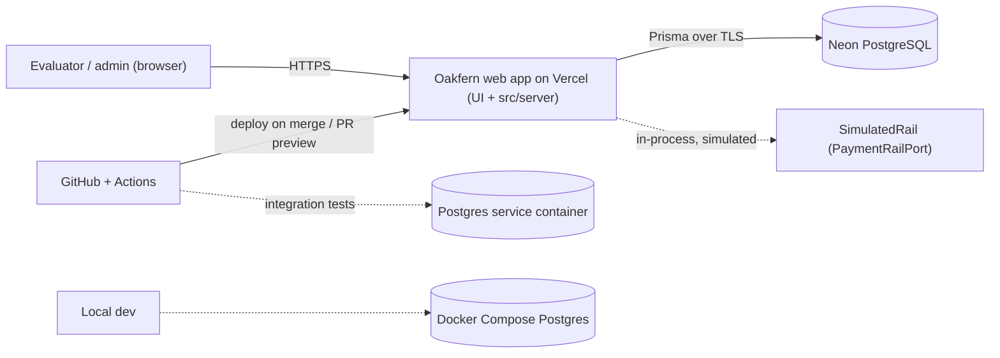

# Architecture — Oakfern

> **Application architecture** (ADR-0001, Accepted): a layered modular monolith with
> `domain → services → repositories`.
> **Deployment** (ADR-0006, Accepted, resolving OQ-003): one Vercel Hobby deployment carrying both
> the frontend and the `src/server` layer, with **Neon** (Free plan) as the managed PostgreSQL host
> for Preview and Production and Docker Compose PostgreSQL locally. No separate backend service.
> Railway and a separate NestJS API were considered and rejected — see ADR-0006.

## System context (actors and external systems)

| Actor / external system | Role | Interaction |
|---|---|---|
| `anonymous` visitor (the evaluator) | Reaches the landing page and starts the demo session | HTTPS, browser |
| `admin` user (demo founder / finance lead) | Reads cash and transactions, moves money, manages cards | HTTPS, browser, authenticated by a signed session cookie |
| `system` context | Lazy settlement, seed, demo reset | In-process server code only; never reachable from a request parameter |
| Neon (managed PostgreSQL) | Source of truth for all business data | TCP/TLS from the server layer, through Prisma; a Neon branch per Vercel preview (ADR-0006) |
| Vercel (Hobby) | Builds, hosts and serves the whole application — frontend and server layer in one deployment; per-PR preview deployments | Git integration |
| GitHub | Source of truth for code; CI (GitHub Actions) and one PR per feature | Git, Actions |
| Payment rails (ACH, wire, card) | **Simulated.** No real network is contacted | `PaymentRailPort` / `SimulatedRail` (ADR-0005) |



## Containers

| Container | Technology | Responsibility | Status |
|---|---|---|---|
| Web application | Next.js App Router (RSC for reads, Server Actions for mutations, Route Handlers for health / CSV / optional REST), deployed on Vercel Hobby | Renders every screen, authenticates, and hosts the server layer | Decided (ADR-0001, ADR-0006) |
| Server layer `src/server` | Plain TypeScript, framework-agnostic, inside the same deployment | Business logic: domain, services, repositories, rails, auth | Decided (ADR-0001) |
| Relational database | Neon PostgreSQL via Prisma (Free plan; a branch per preview) | Single source of truth | Decided (ADR-0006) |
| Separate API service | NestJS | Would re-expose `src/server` over HTTP | **Rejected** (ADR-0006); README "next step" |
| CI | GitHub Actions | lint → typecheck → unit → integration (Postgres service container) → build → e2e | Decided |
| Local environment | Docker Compose PostgreSQL | Development and integration tests | Decided (ADR-0006) |

## Modules and responsibilities

```text
src/
├── app/                               # routes: thin, no business logic
│   ├── (public)/page.tsx              # UI-01 landing + demo login
│   ├── (app)/layout.tsx               # authenticated shell (UI-02…UI-07)
│   ├── (app)/home/ · transactions/ · accounts/[id]/ · payments/ · cards/
│   └── api/health/route.ts · api/v1/transactions/export/route.ts
├── actions/                           # Server Actions: Zod parse → guard → service → revalidate
├── components/ui/                     # shadcn/ui primitives (copied into the repo)
├── components/<feature>/              # feature components; never do money arithmetic (NFR-011)
├── server/
│   ├── domain/                        # PURE: money.ts, balances.ts, metrics.ts, time.ts,
│   │                                  #       transfer-rules.ts, filters.ts, csv.ts
│   ├── services/                      # use cases, orchestration, $transaction boundaries
│   ├── repositories/                  # the ONLY layer importing Prisma; takes businessId always
│   ├── rails/                         # PaymentRailPort + SimulatedRail (ADR-0005)
│   └── auth/                          # session (jose), guards, requireAdmin()
├── lib/                               # formatters (formatCents), url-state helpers, utils
prisma/   schema.prisma · migrations/ · seed.ts
tests/    unit/ · integration/ · e2e/
```

| Layer | May import | Must never import | Enforced by |
|---|---|---|---|
| `server/domain` | nothing but TypeScript standard library and `date-fns` | Next.js, Prisma, React, `process.env`, `new Date()` | ESLint `no-restricted-imports` + review; NFR-007 forbids `any` here |
| `server/services` | `domain`, `repositories`, `rails`, `auth` | React, Next.js request APIs | ESLint + review |
| `server/repositories` | `@prisma/client`, `domain` types | `services`, React, Next.js | ESLint + review |
| `actions`, `app` | `services`, `auth`, `lib`, Zod schemas | `repositories`, `@prisma/client` directly | ESLint + review |
| `components/**` | `lib` formatters, UI primitives | anything under `server/`, any money arithmetic | NFR-011 check |

**Why the layering still matters now that hosting is settled:** because `server/` has no framework
dependency, the rejected option B (a separate NestJS API) stays reachable later as an added adapter
calling the same `services` — a new entry point, not a rewrite (ASM-020). That is what makes the
README "next step" credible rather than aspirational.

## Data

| Topic | Decision |
|---|---|
| Engine | PostgreSQL — Neon (managed) for Preview and Production, Docker Compose locally (ADR-0006) |
| Access | Prisma ORM, confined to `repositories`; every method takes `businessId` as a required argument |
| Money | Signed integer cents in an `Int` column (ADR-0003, BR-001, ASM-017) |
| Time | `DateTime` stored UTC; all boundaries computed in `America/New_York` by `domain/time.ts` (BR-009) |
| Migrations | Prisma Migrate, committed; forward-only during the sprint; each migration's rollback strategy stated in the feature's `plan.md` |
| Indexes | `(businessId, postedAt)`, `(businessId, status, settleAt)`, `(businessId, accountId, postedAt)`, `(businessId, category)`, unique `(businessId, idempotencyKey)` — required by NFR-002 and BR-006 |
| Seed | `prisma/seed.ts`, deterministic (fixed faker seed), dates relative to the run day; re-runnable for the demo reset (FR-036, FR-037) |
| Transactions / atomicity | Money movements run inside one `$transaction`; balance checks re-read inside the transaction so concurrent requests cannot both spend the same funds (NFR-006, FR-030c) |

## Security

| Control | Implementation | Requirement |
|---|---|---|
| Authentication | Signed JWT (jose) in an `httpOnly` + `Secure` + `SameSite=Lax` cookie, 8 h lifetime (ADR-0004, ASM-018) | FR-001, NFR-005 |
| Authorization | One guard resolving `{ userId, businessId, role }`, invoked by **every** Server Action and Route Handler before any work; the UI never decides permissions | FR-002, NFR-005, `roles-permissions.md` |
| Tenant isolation | `businessId` is a required argument of every repository method; cross-business reads return 404 | DV-1, DV-3 |
| Input validation | Zod at every server boundary; the same schema shared with React Hook Form where possible | NFR-005 |
| Secrets | Environment variables only; `.env.example` documents every key; nothing secret in the repo, logs or docs | Art. 8, NFR-005 |
| Sensitive data | Account, routing and card numbers are generated and only ever leave the server masked | DV-2 |
| Headers | CSP, `X-Content-Type-Options`, `Referrer-Policy`, `X-Frame-Options` | NFR-005 |
| CSV safety | Leading `=`, `+`, `-`, `@` neutralised in exported fields | FR-020, NFR-005 |
| Idempotency | Required key on every money mutation, unique per business | BR-006, FR-030 |

## Deployment (ADR-0006, Accepted)

| Aspect | Decision |
|---|---|
| Topology | **One** Vercel Hobby deployment serving the frontend and the `src/server` layer together. No separate backend service. |
| Managed database | **Neon** (Free plan): 1 GB storage per project, 100 CU-hours/month, autosuspend after 5 min, 10 branches, 5 GB egress, no overage billing. Permanent free plan. |
| Local | Docker Compose PostgreSQL (`pnpm db:migrate`, `pnpm db:seed`) |
| Environments | local → Vercel Preview per PR (Neon branch) → Production on `main` (Neon primary) |
| Cost | **USD 0** — TC-2 upheld; no Art. 9 cost approval required |
| Rejected | Railway Postgres (no permanent free tier: one-time USD 5 credit for 30 days, then ~USD 1/month of usage credit, Hobby USD 5/month → the demo would likely go offline ~30 days after submission). A separate NestJS API on Railway (+4–6 h, CORS, cross-domain cookies, two deployments) — kept as a README "next step". |
| Capacity check | The seed (1,200–1,800 transactions, 4 accounts, 5 cards, ~60 counterparties) is a few MB — comfortably inside the 1 GB limit, so no capacity NFR is needed (ASM-022). |
| Live risk | **RSK-04:** autosuspend means the evaluator's first request pays a cold start. Mitigated by NFR-010 skeletons and a README note; the NFR-001 Lighthouse run must be done on a **warmed** deployment. |

Verified facts, sources and the full trade-off table: `docs/adr/0006-deployment-and-database-hosting.md`.

## Observability

| Signal | Implementation | Requirement |
|---|---|---|
| Money-mutation audit log | One structured JSON line per mutation: `userId`, `businessId`, operation, `amountCents`, `idempotencyKey`, result status. No PII, no account numbers | NFR-009 |
| Health | `GET /api/health` reports application status and database reachability, unauthenticated, no secrets | FR-038, NFR-009 |
| Error surfaces | `error.tsx` and `not-found.tsx` per route segment; no stack traces in the browser | FR-039, NFR-009 |
| Platform logs | Hosting provider's log stream (retention per provider default) | NFR-009 |
| Not included | Metrics backend, tracing, alerting — **N/A** for a 24 h evaluation artifact; listed as a README "next step" |

## Testing strategy

| Level | Scope | Tooling | Target |
|---|---|---|---|
| Unit (many) | `src/server/domain`: money parsing and formatting, balances, burn and runway, transfer rules, filter parsing, time-zone and DST boundaries, CSV escaping | Vitest | >= 80 % line coverage in `domain` (NFR-007) |
| Component | Critical UI states (empty, loading, error) and the review step | Vitest + React Testing Library | Key states only |
| Integration (some) | Services against a real PostgreSQL: atomicity, idempotency, balance concurrency, lazy settlement, anti-IDOR, query timing | Vitest + Postgres (Docker locally, service container in CI) | NFR-002, NFR-005, NFR-006 |
| E2E (few) | Flows F-1…F-6 from the brief, plus `@axe-core/playwright` and the NFR-004 viewports | Playwright | NFR-003, NFR-004, NFR-010 |
| Traceability | Every test covering an acceptance criterion carries its ID in the title, e.g. `it('AC-005-03: rejects transfer above available balance', …)` | — | `docs/traceability.md` |

CI gate on every PR: `lint → typecheck → unit → integration → build → e2e`. Merge only on green.

## Decisions (ADR index)

| ADR | Title | Status |
|---|---|---|
| [ADR-0001](../adr/0001-architecture.md) | Application architecture: layered modular monolith | **Accepted** (human, Round 0) |
| [ADR-0002](../adr/0002-stack-and-versions.md) | Stack, UI libraries and pinned versions | **Accepted** (human, 🚦 G-Foundational, 2026-11-09) |
| [ADR-0003](../adr/0003-money-representation.md) | Money representation: signed integer cents | **Accepted** (human, 🚦 G-Foundational, 2026-11-09) |
| [ADR-0004](../adr/0004-session-strategy.md) | Session strategy: signed JWT in an httpOnly cookie | **Accepted** (human, 🚦 G-Foundational, 2026-11-09) |
| [ADR-0005](../adr/0005-simulated-payment-rails.md) | Simulated payment rails behind a port | **Accepted** (human, 🚦 G-Foundational, 2026-11-09) |
| [ADR-0006](../adr/0006-deployment-and-database-hosting.md) | Deployment topology and managed-database host: one Vercel deployment + Neon | **Accepted** (human, 2026-11-09, resolving OQ-003) |
