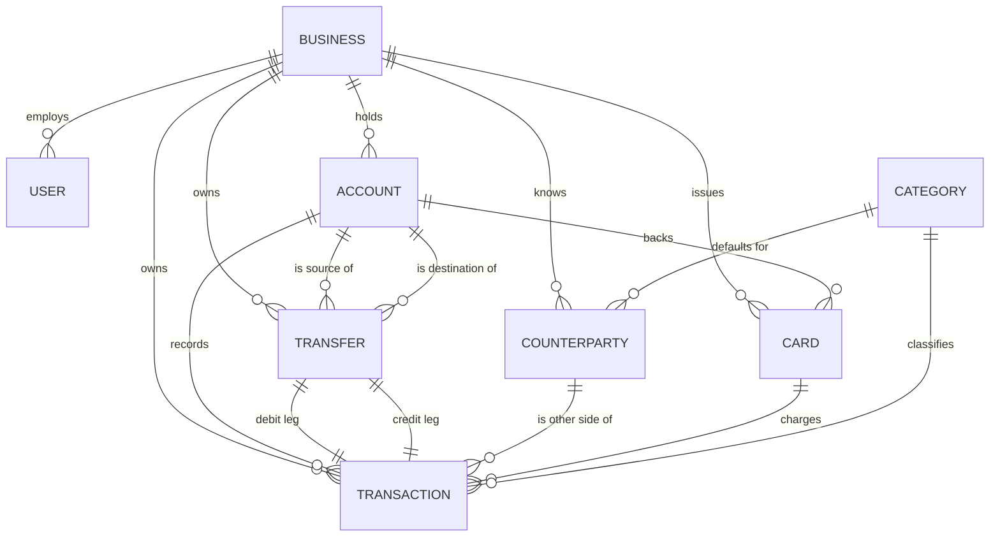
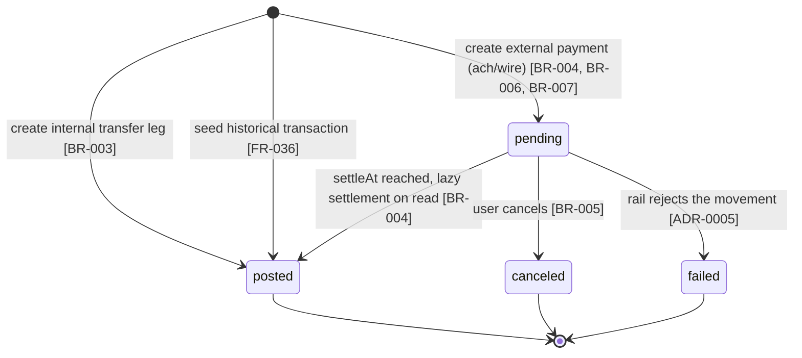
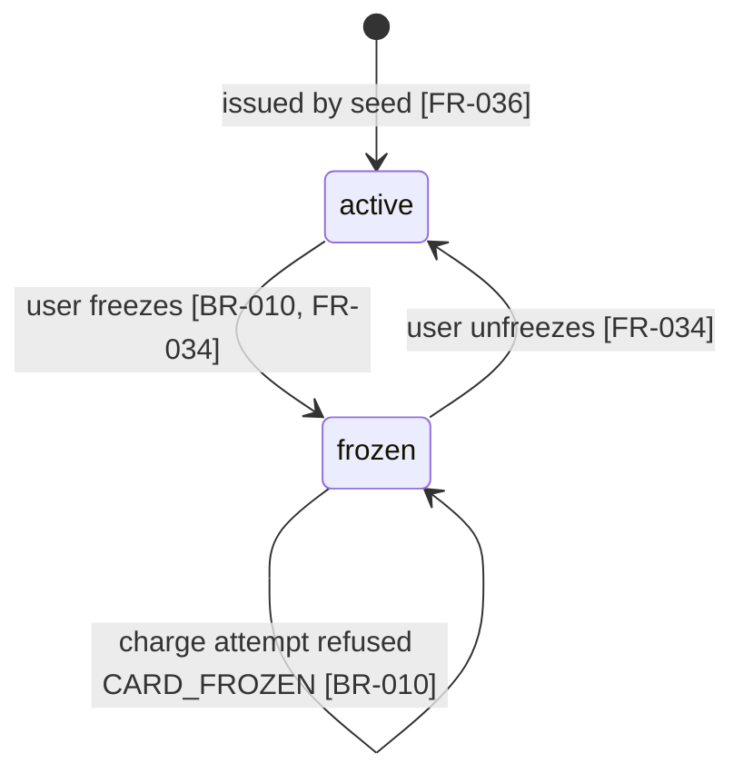
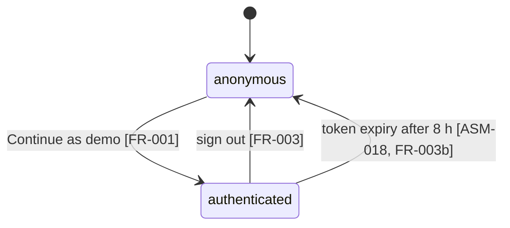

# Domain model

> Names are canonical: they come from `docs/glossary.md` and are the names used in Prisma, in
> `src/server/domain` and in the UI. Money follows BR-001 / ADR-0003 (signed integer cents). Time
> follows BR-009 (stored UTC, bucketed in `America/New_York`).
> `SoT` = source of truth.

## Entities

### Business
- **Description:** The fictional company that owns everything. The tenant boundary: every query in `repositories` takes `businessId`.
- **Key attributes:**

| Attribute | Type | Required | Sensitivity |
|---|---|---|---|
| `id` | cuid | yes | internal |
| `name` | string | yes | public (fictional) |
| `slug` | string, unique | yes | public |
| `createdAt` | DateTime (UTC) | yes | internal |

- **Invariants:** exactly one `Business` exists in the demo deployment (shared demo workspace, ASM-012); `slug` is unique.
- **Data owner / SoT:** the seed (FR-036).

### User
- **Description:** A person who signs in. The MVP seeds exactly one, with role `admin`.
- **Key attributes:**

| Attribute | Type | Required | Sensitivity |
|---|---|---|---|
| `id` | cuid | yes | internal |
| `businessId` | FK Business | yes | internal |
| `email` | string, unique | yes | internal (fictional demo address) |
| `name` | string | yes | public (fictional) |
| `role` | enum `admin` \| `viewer` | yes | internal |
| `passwordHash` | string | no | **restricted** (null for the one-click demo user; present only if the credentials form is built) |
| `createdAt` | DateTime (UTC) | yes | internal |

- **Invariants:** `role` is `admin` for every seeded user (`viewer` is out of scope); `email` is unique; `passwordHash` is never selected into a client payload.
- **Data owner / SoT:** the seed.

### Account
- **Description:** A bank account of the business.
- **Key attributes:**

| Attribute | Type | Required | Sensitivity |
|---|---|---|---|
| `id` | cuid | yes | internal |
| `businessId` | FK Business | yes | internal |
| `name` | string | yes | public |
| `type` | enum `checking` \| `savings` \| `treasury` | yes | internal |
| `accountNumber` | string (generated) | yes | **confidential** — only `maskedNumber` is sent to the client |
| `routingNumber` | string (generated) | yes | **confidential** |
| `currency` | string, fixed `"USD"` | yes | internal |
| `openedAt` | DateTime (UTC) | yes | internal |

- **Invariants:** `currency = 'USD'` always; `currentBalance` and `availableBalance` are **derived**, never stored columns (BR-002), so they can never disagree with the ledger; `availableBalance <= currentBalance`.
- **Data owner / SoT:** `Transaction` rows are the SoT for balances; the account row is the SoT for identity.

### Transaction
- **Description:** One money movement against exactly one account. The atom of the ledger.
- **Key attributes:**

| Attribute | Type | Required | Sensitivity |
|---|---|---|---|
| `id` | cuid | yes | internal |
| `businessId` | FK Business | yes | internal |
| `accountId` | FK Account | yes | internal |
| `amountCents` | Int, signed, non-zero | yes | internal |
| `status` | enum `pending` \| `posted` \| `canceled` \| `failed` | yes | internal |
| `method` | enum `ach` \| `wire` \| `card` \| `internal` \| `check` \| `fee` \| `interest` | yes | internal |
| `category` | FK Category (nullable for `internal`) | no | internal |
| `counterpartyId` | FK Counterparty | no | internal |
| `cardId` | FK Card | no | internal |
| `transferId` | FK Transfer | no | internal |
| `memo` | string (<= 140) | no | internal |
| `note` | string (<= 500) | no | internal |
| `idempotencyKey` | string (uuid), unique per business | no | internal |
| `createdAt` | DateTime (UTC) | yes | internal |
| `settleAt` | DateTime (UTC) | no | internal |
| `postedAt` | DateTime (UTC) | no | internal |

- **Invariants:**
  - `amountCents != 0` and is an integer (BR-001);
  - `status = 'posted'` implies `postedAt != null`; `status = 'pending'` implies `postedAt = null` and `settleAt != null` (BR-004);
  - `method = 'internal'` implies `transferId != null` and `counterpartyId = null`;
  - `method in ('ach','wire')` implies `counterpartyId != null` and `amountCents < 0` (the MVP only sends external money);
  - `method = 'card'` implies `cardId != null` and `amountCents < 0`;
  - `idempotencyKey` is unique within a business when present (BR-006);
  - `|amountCents| <= 25_000_000` for user-created movements (BR-007);
  - every row belongs to the same business as its account, counterparty and card.
- **Data owner / SoT:** itself; the only writable ledger.
- **Indexes (NFR-002):** `(businessId, postedAt)`, `(businessId, status, settleAt)`, `(businessId, accountId, postedAt)`, `(businessId, category)`, unique `(businessId, idempotencyKey)`.

### Transfer
- **Description:** Aggregate linking the two `Transaction` legs of one internal transfer.
- **Key attributes:**

| Attribute | Type | Required | Sensitivity |
|---|---|---|---|
| `id` | cuid | yes | internal |
| `businessId` | FK Business | yes | internal |
| `sourceAccountId` | FK Account | yes | internal |
| `destinationAccountId` | FK Account | yes | internal |
| `amountCents` | Int, positive | yes | internal |
| `idempotencyKey` | string (uuid), unique per business | yes | internal |
| `createdAt` | DateTime (UTC) | yes | internal |

- **Invariants:** exactly two `Transaction` rows reference each `Transfer`, one with `−amountCents` on the source and one with `+amountCents` on the destination, both `posted` (BR-003); `sourceAccountId != destinationAccountId`; `amountCents > 0`; both accounts belong to `businessId`.
- **Data owner / SoT:** itself for the transfer intent; the two transactions for the ledger effect.

### Counterparty
- **Description:** The other side of an external movement: a payment recipient or a merchant.
- **Key attributes:**

| Attribute | Type | Required | Sensitivity |
|---|---|---|---|
| `id` | cuid | yes | internal |
| `businessId` | FK Business | yes | internal |
| `name` | string | yes | public (merchant text as on a statement, no logos) |
| `kind` | enum `recipient` \| `merchant` | yes | internal |
| `accountNumber` | string (generated) | no | **confidential** — masked on the client |
| `routingNumber` | string (generated) | no | **confidential** |
| `defaultCategoryId` | FK Category | no | internal |
| `createdAt` | DateTime (UTC) | yes | internal |

- **Invariants:** `kind = 'recipient'` requires generated destination details before it can receive an ACH or wire; names are unique per business (case-insensitive) to avoid duplicates in the picker.
- **Data owner / SoT:** the seed, plus `admin` creations through FR-028.

### Card
- **Description:** A virtual or physical card tied to one account, with a monthly spend limit.
- **Key attributes:**

| Attribute | Type | Required | Sensitivity |
|---|---|---|---|
| `id` | cuid | yes | internal |
| `businessId` | FK Business | yes | internal |
| `accountId` | FK Account | yes | internal |
| `holderName` | string | yes | public (fictional) |
| `formFactor` | enum `virtual` \| `physical` | yes | internal |
| `last4` | string(4) (generated) | yes | internal — rendered as `maskedNumber` |
| `status` | enum `active` \| `frozen` | yes | internal |
| `monthlyLimitCents` | Int, `0..10_000_000` | yes | internal |
| `createdAt` | DateTime (UTC) | yes | internal |

- **Invariants:** `0 <= monthlyLimitCents <= 10_000_000` (BR-010); a `frozen` card accepts no new charge; `monthToDateUsageCents` is derived, never stored; the card's account belongs to the same business.
- **Data owner / SoT:** the seed, plus `admin` edits through FR-034 and FR-035.

### Category
- **Description:** Business classification of a transaction. Modelled as a **table**, not an enum, so recategorize (FR-018) and spending-by-category (FR-023) have stable ids and display labels.
- **Key attributes:**

| Attribute | Type | Required | Sensitivity |
|---|---|---|---|
| `id` | cuid | yes | internal |
| `key` | string, unique (for example `payroll`) | yes | public |
| `label` | string (for example "Payroll") | yes | public |
| `direction` | enum `in` \| `out` \| `both` | yes | internal |
| `sortOrder` | Int | yes | internal |

- **Invariants:** `key` is unique and stable (URLs and chart drill-downs reference it, FR-025); the seeded set is global, not per business; an `out` category is never assigned to an inflow.
- **Seeded set:** `revenue`, `interest`, `payroll`, `contractors`, `rent`, `software`, `cloud`, `marketing`, `travel`, `meals`, `insurance`, `taxes`, `fees`, `other`.
- **Data owner / SoT:** the seed.

## Relationships

| Relationship | Cardinality | Notes |
|---|---|---|
| Business → User | 1..N | MVP: exactly 1 user |
| Business → Account | 1..N | MVP: 4 accounts |
| Account → Transaction | 1..N | each transaction touches exactly one account |
| Transfer → Transaction | 1..2 (exactly 2) | the two legs of an internal transfer (BR-003) |
| Counterparty → Transaction | 0..N | null for internal transfers, fees and interest |
| Card → Transaction | 0..N | only `method = 'card'` rows |
| Category → Transaction | 0..N | nullable for internal legs (BR-011) |

## Lifecycles

### Transaction state machine

| From | To | Trigger | Rule | Effect on balances |
|---|---|---|---|---|
| — | `pending` | external payment confirmed | BR-004, BR-006, BR-007 | reduces `availableBalance` only |
| — | `posted` | internal transfer confirmed, or seed | BR-003 | changes `currentBalance` and `availableBalance` |
| `pending` | `posted` | `settleAt <= now` on a read | BR-004 | moves the amount into `currentBalance` |
| `pending` | `canceled` | user cancellation | BR-005 | releases `availableBalance` |
| `pending` | `failed` | simulated rail rejection | ADR-0005 | releases `availableBalance` |
| `posted` | anything | — | **forbidden**: a posted transaction is immutable except for `category` and `note` (FR-018, FR-019) | — |

### Card state machine

### Session lifecycle

## Data classification

| Data | Class | Encryption at rest | Retention |
|---|---|---|---|
| `Business.name`, `Business.slug` | public (fictional) | Neon volume encryption (provider default) | until the next demo reset |
| `User.email`, `User.name` | internal (fictional demo identity) | provider default | until the next demo reset |
| `User.passwordHash` | restricted | provider default; bcrypt hash, never returned by any query selecting for the client | until the next demo reset |
| `Account.accountNumber`, `Account.routingNumber` | confidential (generated, fictional) | provider default; only `maskedNumber` crosses the network | until the next demo reset |
| `Counterparty.accountNumber`, `Counterparty.routingNumber` | confidential (generated, fictional) | provider default; masked on the client | until the next demo reset |
| `Card.last4` | internal (generated) | provider default | until the next demo reset |
| `Transaction.*` (amounts, memo, note, categories) | internal (fictional) | provider default | until the next demo reset |
| Session JWT | restricted | signed with `SESSION_SECRET` from the environment; cookie `httpOnly` + `Secure` + `SameSite=Lax`; never logged | 8 h |
| Structured money-mutation logs | internal | Vercel log retention (provider default) | provider default; contains no account numbers and no PII (NFR-009) |

> **Art. 8 note.** No real personal or financial data exists anywhere in this system, in any
> environment. All numbers, names and addresses are generated by `@faker-js/faker` with a fixed
> seed. Counterparty names may reproduce real brand names as statement text, without logos or any
> claim of affiliation (brief §6).
