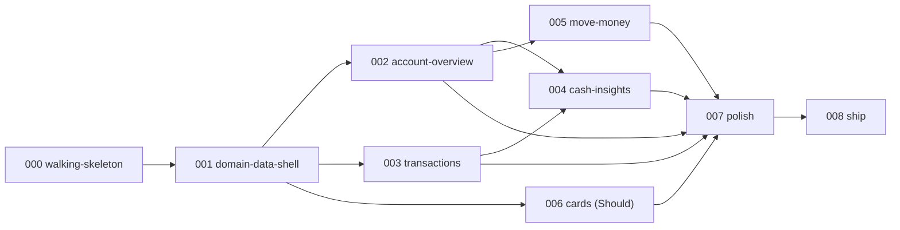

# Roadmap

> Source: KICKOFF §5. Vertical slices: each feature delivers end-to-end value (UI → logic → data),
> can be demoed on its own, and is deployed on merge.
> **Deadline: 2026-11-10 18:00 America/New_York.** Project start: 2026-11-09 ~17:00 ET.
> Status values: Not started | Spec | Plan | In progress | In validation | Merged.

## ✂️ Scope cut — decided by the Technical Director, 2026-11-09 20:50 ET

The deadline is 2026-11-10 18:00 ET, but the **human-available working time is 12 h 45 min**, not
~21 h: 3 h 45 min tonight (20:45 → 00:30) and 9 h tomorrow (09:00 → 18:00). The plan as written
needed ~19 h 50 min, so roughly 40 % of scope was cut. Two further drivers: feature 000's Art. 14
verification showed Prisma 7's setup surface was mispriced (+90 % on the best-specified feature), and
the human is on a **Pro ($20) plan**, where heavyweight sub-agent calls are a hard constraint — one
planner agent was already killed by a session limit tonight.

| Spec | Decision | Revised box | Rationale |
|---|---|---|---|
| 000, 001 | **Keep in full** | 3 h 00 (amended) · 2 h 30 | Everything else stands on them |
| 002 | **Keep in full** | 2 h 00 | It *is* the dashboard: KPIs, burn, runway. Highest signal per hour |
| 003 | **Must only** — CSV export and recategorize+note **cut** | 2 h 15 | Filters + pagination + URL state already demonstrate the craft |
| 004 | **CUT** | — | Recharts is mostly configuration; 002 already ships a sparkline. Lowest technical signal per hour |
| 005 | **Reduced** — internal transfer only, keeping idempotency (BR-003/BR-006) and the BR-002 invariant. ACH/wire, recipients, review step and simulated settlement **cut** | 1 h 30 | The feature that best demonstrates backend judgment; cutting it entirely would be the real mistake |
| 006 | **CUT** | — | Was already `Should`, and first in the pre-agreed cut order |
| 007 | **DISSOLVED into 008** | — | The empty/loading/error sweep happens task by task, not as a phase |
| 008 | **Keep in full** | 1 h 00 | Without a README explaining the architecture and the AI-assisted workflow, none of the rest can be evaluated |

**Revised total: ~11 h 45 min against 12 h 45 min available.** Still tight. If 001 overruns the way
000 did, the next cuts are 005 entirely, then 003's side detail panel.

**Delivered areas: 3 of the 5 the case study names** — accounts, transactions and money movement.
Cash insights and cards are consciously out, and the README must say so plainly rather than let the
evaluator wonder.

### Sprint Profile amendments approved at the same time (Pro-plan token budget)
- **Planning collapses to one `planner` invocation per feature** (spec + plan + tasks together).
  `/sdd-clarify` runs **only** where money mathematics is involved: features 002 and 005.
- **SP-5 downgraded to a single `combined` reviewer for every feature**, replacing the three parallel
  reviewers previously required for 002–005.

### Second cut — delivery day, 2026-11-10 11:50 ET

The 11:00 checkpoint recorded in `MEMORY.md` was missed: feature 001's UI block (T-10…T-13) ran
**2 h 40 against a ~56 min calibrated estimate**, roughly 3×, for two documented reasons — the
shadcn 4.23 CLI resolving a different dependency set than the plan assumed, and a measured Next.js
behaviour where `loading.tsx` beside a catch-all flushed the Suspense shell and answered **200 with
404 content**, fixed with URL-neutral `(section)` route groups. At 11:50 there were 6 h 10 left
against roughly 8 h of remaining work.

**Decided by the Technical Director:**
- **005 `move-money` is CUT entirely.** The 0.43 calibration factor that justified keeping it did not
  survive contact with UI work.
- **Feature 008 `ship` starts at 16:15 ET regardless of where 003 has reached.** This is a clock
  rule, not an estimate: without a README and a verified production deployment nothing else can be
  evaluated, so 008 is protected ahead of any remaining feature work.
- 003 is reduced further if needed to respect that boundary.

**Delivered areas: 2 of the 5 the case names** — accounts and transactions. Money movement, cash
insights and cards are consciously out, and the README must say so plainly, with the reason.

## Features

| Spec | Feature | FRs covered | CR | Priority | Depends on | Timebox | Validation (SP-5) | Status |
|---|---|---|---|---|---|---|---|---|
| 000 | `walking-skeleton` — Next.js + TS strict + ESLint/Prettier + Vitest (1 real test) + Playwright (1 e2e) + Prisma with PostgreSQL + `GET /api/health` + GitHub Actions CI + Vercel deployment with Neon | FR-038, FR-039 (shell) | CR-6 | Must | — | ~~1 h 45 min~~ → **3 h 00 (amended at 🚦 G-SpecPlan)** | 1 reviewer, `combined` | 🚦 G-SpecPlan **approved** 2026-11-09 20:50 ET; implementing |
| 001 | `domain-data-shell` — Prisma schema + migrations + deterministic realistic seed + demo session + app shell (sidebar, topbar, theme, responsive layout) + error/not-found states | FR-001…FR-006, FR-036, FR-039 | CR-1, CR-3 | Must | 000 | **2 h 30 min** | 1 reviewer, `combined` | Not started |
| 002 | `account-overview` — KPIs (total cash, 30-day in/out, net burn, runway), account cards, pending payments, recent transactions, cash sparkline | FR-007…FR-012b | CR-2 | Must | 001 | **2 h** | 3 reviewers in parallel | Not started |
| 003 | `transactions` — search, combinable filters, sorting, server-side pagination with URL state, side detail panel, recategorize + note (Should), CSV export (Should) · **plus the NFR-003 a11y entry point deferred from 000: install `@axe-core/playwright` (TD-008, verify at install time) and run the axe scan over `/` as well as UI-03, including the >= 4.5:1 contrast check on the `/` placeholder if it still exists** | FR-013…FR-020b + NFR-003 | CR-3 | Must | 001 | **3 h** | 3 reviewers in parallel | Not started |
| ~~004~~ | **CUT 2026-11-09.** ~~`cash-insights` — monthly cash flow, balance over time, spending by category, period selector, drill-down to transactions | FR-021…FR-025 | CR-4 | Must | 002, 003 | **2 h 15 min** | 3 reviewers in parallel | Not started |
| ~~005~~ | **CUT 2026-11-10.** ~~`move-money` — internal transfer + ACH/wire payment + recipients + review step + idempotency + simulated settlement + cancel pending | FR-026…FR-032 | CR-5 | Must | 002 | **3 h** | 3 reviewers in parallel | Not started |
| ~~006~~ | **CUT 2026-11-09.** ~~`cards` — list, freeze/unfreeze, monthly limit and usage | FR-033…FR-035 | CR-5 | Should | 001 | **1 h 15 min** | 1 reviewer, `combined` | Not started |
| ~~007~~ | **DISSOLVED into 008, 2026-11-09.** ~~`polish` — a11y and responsive audit, empty/loading/error states sweep, performance (Lighthouse on a warmed deployment), command palette (Could), read-only API (Could) | FR-039, FR-040, FR-042 + NFR-001, NFR-003, NFR-004, NFR-008, NFR-010 | CR-1 | Must | 002–006 | **1 h 30 min** | 1 reviewer, `combined` | Not started |
| 008 | `ship` — README with architecture and the AI-assisted workflow, light/dark screenshots, demo reset, production verification, submission email draft | FR-037, FR-043 | CR-7 | Must | all | **1 h** | 1 reviewer, `combined` | Not started |

## Dependency graph

## Budget

| Item | Estimate |
|---|---|
| Features 000–008 | ~18 h 15 min |
| Genesis (G0–G4) | ~1 h 30 min |
| **Total** | **≈ 19 h 45 min** |
| Buffer to the deadline | ~4 h |

## Scope-cut order (SP-6)

Applied when a feature exceeds its timebox by +30 %, or when the remaining time no longer covers the
remaining features:

1. Drop **006 `cards`** (Should).
2. Drop the **Could** items: command palette (FR-040), account detail (FR-041), read-only API (FR-042).
3. Reduce **004** to **2 charts** (keep monthly cash flow and spending by category; drop balance over time).
4. Drop **CSV export** (FR-020).
5. Drop **recategorize and note** (FR-018, FR-019).

**Early-submission goal:** if fewer than 6 h remain when 005 is merged, skip 006 and go straight to
007–008.

## Blockers and prerequisites per feature

| Spec | Prerequisite | Status |
|---|---|---|
| 000 | 🚦 G-Foundational approved; 🚦 G-Harness approved; OQ-008 (Art. 9 permissions) | 🚦 G-Foundational **approved 2026-11-09**; 🚦 G-Harness **approved 2026-11-09**. OQ-008: push to the public repo and connecting the Neon project `sweet-feather-13830390` **authorised**; **production-deployment authorisation deferred by the Technical Director on 2026-11-09** — 000 no longer requires it to close. 000 closes at 🚦 G-Merge on green CI plus a working Vercel **Preview** (spec 000 AC-000-12a). |
| 000 → open | **AC-000-12b (deferred, open row):** production deployment + `GET <production-url>/api/health` returning `200` with `status:"ok"` against Neon | **Open.** Blocked only on the human granting OQ-008's production-deployment authorisation; re-run then. Feature 008 verifies production again regardless (FR-043). Does **not** block features 001–007. |
| 000 | A reachable local PostgreSQL | **OQ-006 resolved 2026-11-09:** Docker Compose PostgreSQL, keeping local and CI identical; the human is starting Docker Desktop. A Neon branch stays a documented contingency only (RSK-07). |
| 000 | PR flow without the `gh` CLI | **OQ-007 resolved 2026-11-09:** `gh` will not be installed; pull requests are created through the GitHub web UI (RSK-08). |
| 001 | Brand decisions OQ-004 (accent colour) and OQ-005 (typeface) | **Resolved 2026-11-09:** deep **teal** single accent on cool slate neutrals; typeface **Geist** via `next/font`. |
| 001 | Home and Transactions wireframes approved (`docs/ux/ui-brief.md` §8) | **Approved 2026-11-09** as drawn (KPI order, charts inside Home, 5-item sidebar, right-hand detail panel). |
| 002, 004 | BR-008 burn and runway formulas ratified (ASM-008) | **Ratified 2026-11-09** |
| 005 | BR-003…BR-007 ratified (ASM-003…ASM-007) | **Ratified 2026-11-09** |
| 007 | NFR-008 degraded fallback accepted if time is short (ASM-015, chromium only) | **Accepted 2026-11-09** |

## Technical debt

| ID | Description | Impact | Proposal | Status |
|---|---|---|---|---|
| TD-001 | Rails are simulated behind `PaymentRailPort`; there is no real ACH or wire integration | None for the case study; a real product needs a provider adapter and webhook handling | Implement a second adapter behind the existing port (ADR-0005) | Accepted by design |
| TD-002 | Settlement is lazy (observation-driven), so a pending row can sit past `settleAt` until someone reads | Minor realism gap, documented in the README | Add a scheduled job calling the existing `settleDuePayments` service (ADR-0005) | Accepted by design |
| TD-003 | NestJS is not demonstrated in running code (ADR-0001 option B rejected on deadline risk) | May read as "frontend only" to an evaluator (ASM-013) | Mitigated by the `src/server` layering, ADR-0001 and a README "next step"; add a NestJS adapter over the same services if ever needed | Accepted by design |
| TD-004 | Recategorize (FR-018) and note edits (FR-019) overwrite the previous value with no change history | No audit trail for classification changes | Add a `TransactionChange` audit table | Open |
| TD-005 | The `viewer` role is designed in the RBAC matrix but not implemented | Demo shows a single role | Seed a second user and extend the guard; no UI switcher (`roles-permissions.md`) | Out of scope (Round 0) |
| TD-006 | Single shared demo workspace: concurrent evaluators can see each other's mutations (ASM-012) | Possible confusion if two evaluators browse simultaneously | "Reset demo data" button (FR-037); a per-visitor workspace is the Could alternative | Accepted by design |
| TD-007 | No metrics backend, tracing or alerting; observability is structured logs plus `/api/health` | Acceptable for an evaluation artifact | Listed as a README "next step" | Accepted by design |
| TD-008 | Four dependency versions (`@axe-core/playwright`, `@date-fns/tz`, `lucide-react`, `sonner`) are unverified and must be checked at install time (ADR-0002) | Risk of a guessed version breaking the build | The Implementer verifies each against the npm registry and records the resolved version in the feature's `plan.md` | **Open — carried forward, no longer due in 000.** Feature 000 installs none of the four: `@axe-core/playwright` was deliberately deferred to **003** by the human on 2026-11-09 to protect the 000 timebox (spec 000 v0.3); `lucide-react` and `sonner` are due in **001** with the shadcn flow; `@date-fns/tz` only if a tz helper proves necessary (001 / 002). Each is verified at install time by the feature that first uses it. |
| TD-009 | Prisma pinned to `7.10.1` because the CLI's `latest` dist-tag points at `8.0.0-rc.33` (RSK-09) | A major ORM line behind `latest` | Re-evaluate once Prisma 8 reaches GA, before any migration is written | Open |
| TD-010 | No overage billing on Neon Free: writes fail at the 1 GB storage cap rather than costing money | Not reachable at the seed's few-MB footprint (ASM-022) | Observe the database size after the first seed in feature 000 | Accepted by design |
