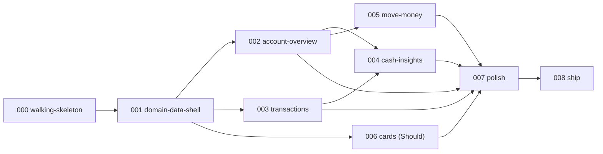

# Roadmap

> Source: KICKOFF §5. Vertical slices: each feature delivers end-to-end value (UI → logic → data),
> can be demoed on its own, and is deployed on merge.
> **Deadline: 2026-11-10 16:45 America/New_York** (corrected by the Technical Director on
> 2026-11-10 at 10:45 ET; every earlier "18:00" in this file was wrong and has been fixed).
> Project start: 2026-11-09 ~17:00 ET.
> Status values: Not started | Spec | Plan | In progress | In validation | Merged | CUT.
>
> ## 📦 Final state at submission — 2026-11-10, feature 008
>
> | Spec | Final status |
> |---|---|
> | 000 `walking-skeleton` | **Merged** and deployed |
> | 001 `domain-data-shell` | **Merged** (PR #2, `main` → `6b6f05c`), verified in production. `/sdd-validate 001 combined` was **deferred by the Technical Director** — 001's assurance rests on CI evidence, not on an independent validation pass |
> | 002 `account-overview` | **Merged** 2026-11-10 19:48 UTC (PR #3, all four checks green, `main` → `fec01b6`) and **live in production**, verified in a browser. 🚦 G-Merge approved by the Technical Director after `/sdd-validate 002 combined` (PASS WITH FINDINGS → F-01 MAJOR fixed in `a5da5ac`, F-06 in `e690de1`, the Vercel build failure in `eafc4c3`) |
> | 003 `transactions` | **CUT** 2026-11-10 ~11:30 ET — see "Third cut" below |
> | 004 `cash-insights` | **CUT** 2026-11-09 20:50 ET |
> | 005 `move-money` | **CUT** 2026-11-10 (morning) |
> | 006 `cards` | **CUT** 2026-11-09 20:50 ET |
> | 007 `polish` | **DISSOLVED** into 008, 2026-11-09 |
> | 008 `ship` | README, traceability refresh, roadmap refresh, submission email — documents only |
>
> **Delivered areas: 1 of the 5 the case names — accounts (the overview).** Transactions, cash
> insights, money movement and cards are consciously out. `README.md` §1 states this, with the
> reason and the order the cuts were taken, before anything else.
>
> ⚠️ **Wall-clock discipline (lesson, 2026-11-10).** Several timestamps in this document were
> **invented** by an agent. **Read the clock from a tool, never write a time from memory.** Any
> stamp older than 2026-11-10 10:45 ET is unverified; treat it as approximate. The same lesson is
> recorded in `MEMORY.md`.

## ✂️ Scope cut — decided by the Technical Director, 2026-11-09 20:50 ET

The deadline is 2026-11-10 **16:45** ET, but the **human-available working time is 11 h 30 min**, not
~21 h: 3 h 45 min tonight (20:45 → 00:30) and 7 h 45 min tomorrow (09:00 → 16:45). *(The figures
originally recorded here — 12 h 45 min and "9 h tomorrow" — were computed against a wrong 18:00
deadline and are corrected in place; the cut decisions themselves stand.)* The plan as written
needed ~19 h 50 min, so roughly 40 % of scope was cut. Two further drivers: feature 000's Art. 14
verification showed Prisma 7's setup surface was mispriced (+90 % on the best-specified feature), and
the human is on a **Pro ($20) plan**, where heavyweight sub-agent calls are a hard constraint — one
planner agent was already killed by a session limit tonight.

| Spec | Decision | Revised box | Rationale |
|---|---|---|---|
| 000, 001 | **Keep in full** | 3 h 00 (amended) · 2 h 30 | Everything else stands on them |
| 002 | **Keep in full** | 2 h 00 | It *is* the dashboard: KPIs, burn, runway. Highest signal per hour |
| 003 | **Must only** — CSV export and recategorize+note **cut** | 2 h 15 | Filters + pagination + URL state already demonstrate the craft |
| 004 | **CUT** | — | Recharts is mostly configuration; 002 already ships a sparkline. Lowest technical signal per hour |
| 005 | **Reduced** — internal transfer only, keeping idempotency (BR-003/BR-006) and the BR-002 invariant. ACH/wire, recipients, review step and simulated settlement **cut** | 1 h 30 | The feature that best demonstrates backend judgment; cutting it entirely would be the real mistake |
| 006 | **CUT** | — | Was already `Should`, and first in the pre-agreed cut order |
| 007 | **DISSOLVED into 008** | — | The empty/loading/error sweep happens task by task, not as a phase |
| 008 | **Keep in full** | 1 h 00 | Without a README explaining the architecture and the AI-assisted workflow, none of the rest can be evaluated |

**Revised total: ~11 h 45 min against 11 h 30 min available** (recomputed against the correct 16:45 ET
deadline — it was already **over**, which is why the second cut below followed). Still tight. If 001 overruns the way
000 did, the next cuts are 005 entirely, then 003's side detail panel.

**Delivered areas as projected by this first cut: 3 of the 5 the case study names** — accounts,
transactions and money movement. *(Superseded. The second cut below removed 005, and 003 was cut on
delivery day; the figure that holds at submission is **1 of 5** — see the final-state table at the
top of this file.)*

### Sprint Profile amendments approved at the same time (Pro-plan token budget)
- **Planning collapses to one `planner` invocation per feature** (spec + plan + tasks together).
  `/sdd-clarify` runs **only** where money mathematics is involved: features 002 and 005.
- **SP-5 downgraded to a single `combined` reviewer for every feature**, replacing the three parallel
  reviewers previously required for 002–005.

### Second cut — delivery day, 2026-11-10 (morning; exact wall-clock not recorded)

> **Stamp corrected 2026-11-10.** The "11:50 ET" originally written here was **fabricated** by an
> agent and is not evidence of anything. What is corroborated: the decisions below were taken by the
> Technical Director on the morning of 2026-11-10, **after** the 10:45 ET deadline correction and
> **before** the 11:15 ET clock rule. Where a precise minute is not known, it is not written.

The morning checkpoint recorded in `MEMORY.md` was missed: feature 001's UI block (T-10…T-13) ran
**2 h 40 against a ~56 min calibrated estimate**, roughly 3×, for two documented reasons — the
shadcn 4.23 CLI resolving a different dependency set than the plan assumed, and a measured Next.js
behaviour where `loading.tsx` beside a catch-all flushed the Suspense shell and answered **200 with
404 content**, fixed with URL-neutral `(section)` route groups. At that point roughly **5 h** were
left against roughly 8 h of remaining work. *(The previous sentence claimed "6 h 10 left" — that
figure came from the wrong 18:00 deadline; against 16:45 ET a late-morning checkpoint leaves about
5 h.)*

**Decided by the Technical Director:**
- **005 `move-money` is CUT entirely.** The 0.43 calibration factor that justified keeping it did not
  survive contact with UI work.
- **Feature 008 `ship` starts at 15:30 ET regardless of where 003 has reached.** This is a clock
  rule, not an estimate: without a README and a verified production deployment nothing else can be
  evaluated, so 008 is protected ahead of any remaining feature work.
  ⚠️ **Corrected 2026-11-10 11:15 ET by the Technical Director: 15:30, not 16:15.** The old 16:15 was
  derived from the wrong 18:00 deadline and left 008 only 30 minutes for a README, screenshots,
  production verification and the submission email. **003 absorbs the cut: whatever is unfinished at
  15:30 ET is dropped.** 002 stays whole (with its own L-2/L-4 cuts already applied).
- 003 is reduced further if needed to respect that boundary.

**Delivered areas as projected by this second cut: 2 of the 5 the case names** — accounts and
transactions. *(Superseded within the same morning: **003 was cut too**, at roughly 11:30 ET, so
the figure at submission is **1 of 5** — accounts only. See the final-state table at the top of this
file and `README.md` §1.)*

### Third cut — 2026-11-10 ~11:30 ET

- **003 `transactions` is CUT entirely.** Starting a 2 h 15 feature that close to the 16:45 ET
  deadline would have produced neither a finished feature nor a finished submission, and 008 is
  protected by the 15:30 ET clock rule above. The decision was taken by the Technical Director and is
  **not to be reopened**.
- A related proposal to trim the end-to-end sweep to 1280 px only, saving ~15 min, was **rejected**:
  the single real rendering defect of the whole project was a 3 px horizontal overflow at 375 px that
  was invisible on Windows. The 375 px check is never traded for time.
- 002 stayed whole, with its own L-2 and L-4 cuts already applied.

## Features

| Spec | Feature | FRs covered | CR | Priority | Depends on | Timebox | Validation (SP-5) | Status |
|---|---|---|---|---|---|---|---|---|
| 000 | `walking-skeleton` — Next.js + TS strict + ESLint/Prettier + Vitest (1 real test) + Playwright (1 e2e) + Prisma with PostgreSQL + `GET /api/health` + GitHub Actions CI + Vercel deployment with Neon | FR-038, FR-039 (shell) | CR-6 | Must | — | ~~1 h 45 min~~ → **3 h 00 (amended at 🚦 G-SpecPlan)** | 1 reviewer, `combined` — **done**, `specs/000-walking-skeleton/validation.md` | ✅ **Merged** and deployed. AC-000-12b (production health check) closed by 001's production verification; AC-000-07 still has no automated test (TD-013) |
| 001 | `domain-data-shell` — Prisma schema + migrations + deterministic realistic seed + demo session + app shell (sidebar, topbar, theme, responsive layout) + error/not-found states | FR-001…FR-006, FR-036, FR-039 | CR-1, CR-3 | Must | 000 | **2 h 30 min** | 1 reviewer, `combined` — ⚠️ **deferred by the Technical Director, never run** | ✅ **Merged 2026-11-10** (PR #2, `main` → `6b6f05c`), CI green, verified in production: demo sign-in → `/home`, zero overflow at 375 px, console clean, `/api/health` 200 `database:"ok"`. ⚠️ **Shipped without an independent validation pass** — `/sdd-validate 001 combined` was deferred by the Technical Director for time, so there is no `validation-combined.md` for 001 and its assurance rests on CI evidence. Stated in `README.md` §6 |
| 002 | `account-overview` — KPIs (total cash, 30-day in/out, net burn, runway), account cards, recent transactions **with the pending payments folded in, read-only** · ~~cash sparkline~~ **dropped (L-4)** · ~~dedicated pending panel~~ **dropped (L-2)** | FR-007…FR-012 (**FR-011 degraded to read-only; FR-012b deferred**) | CR-2 | Must | 001 | **2 h 00 — with cut ladder L-2 and L-4 already applied.** ⚠️ This box does **not** cover full FR-007…FR-012b scope; the raw uncalibrated estimate for the reduced scope is 2 h 55 min (`specs/002-account-overview/plan.md` §8) | 1 reviewer, `combined` (Sprint Profile amendment) — **done**, `specs/002-account-overview/validation-combined.md` | ✅ **Merged 2026-11-10** (PR #3, `main` → `fec01b6`, all four checks green including the Vercel deployment) and **verified live in production**: demo sign-in → `/home`, total cash $913,518.54 across 4 accounts, in +$254,746.64, out −$281,636.79, runway 18.0 months at $50,751.03 net burn; the recent list shows the Nov 10 card charges and the three pending payments (F-01 fix live), no `/move-money` link in the banner (F-06 fix live), zero overflow and 0 console messages at 375 px. Implemented T-00…T-07 in **29 min** against a 2 h 55 estimate, no residual cut applied. Local gate: lint 0 · typecheck 0 · unit 67 · integration 29 · build 0 · e2e 25. Validation **PASS WITH FINDINGS** (0 blocker, 1 MAJOR, 5 minor): **F-01** (MAJOR, recent list ordered by `postedAt desc` with Postgres NULLS FIRST) fixed in `a5da5ac` with an integration test proved red first, **F-06** in `e690de1`, the Vercel cache/`postinstall` build failure in `eafc4c3`. 26 of 28 active ACs met, 2 partial (AC-002-16, AC-002-26), and 3 of the 26 proved without a test carrying their id (AC-002-19, AC-002-20, AC-002-30 — F-04) — `docs/traceability.md` |
| ~~003~~ | **CUT 2026-11-10 ~11:30 ET.** ~~`transactions` — search, combinable filters, sorting, server-side pagination with URL state, side detail panel, recategorize + note (Should), CSV export (Should) · **plus the NFR-003 a11y entry point deferred from 000: install `@axe-core/playwright` (TD-008, verify at install time) and run the axe scan over `/` as well as UI-03, including the >= 4.5:1 contrast check on the `/` placeholder if it still exists** | FR-013…FR-020b + NFR-003 | CR-3 | Must | 001 | **3 h** | n/a — cut before spec | ✂️ **CUT.** Never specified, never started. The deferred NFR-003 axe entry point (`@axe-core/playwright`, TD-008) therefore **never ran**: there is no accessibility scan in this project |
| ~~004~~ | **CUT 2026-11-09.** ~~`cash-insights` — monthly cash flow, balance over time, spending by category, period selector, drill-down to transactions | FR-021…FR-025 | CR-4 | Must | 002, 003 | **2 h 15 min** | n/a — cut | ✂️ **CUT** |
| ~~005~~ | **CUT 2026-11-10.** ~~`move-money` — internal transfer + ACH/wire payment + recipients + review step + idempotency + simulated settlement + cancel pending | FR-026…FR-032 | CR-5 | Must | 002 | **3 h** | n/a — cut | ✂️ **CUT** |
| ~~006~~ | **CUT 2026-11-09.** ~~`cards` — list, freeze/unfreeze, monthly limit and usage | FR-033…FR-035 | CR-5 | Should | 001 | **1 h 15 min** | n/a — cut | ✂️ **CUT** |
| ~~007~~ | **DISSOLVED into 008, 2026-11-09.** ~~`polish` — a11y and responsive audit, empty/loading/error states sweep, performance (Lighthouse on a warmed deployment), command palette (Could), read-only API (Could) | FR-039, FR-040, FR-042 + NFR-001, NFR-003, NFR-004, NFR-008, NFR-010 | CR-1 | Must | 002–006 | **1 h 30 min** | n/a — dissolved | ✂️ **DISSOLVED into 008** |
| 008 | `ship` — README with architecture and the AI-assisted workflow, light/dark screenshots, demo reset, production verification, submission email draft | FR-037, FR-043 | CR-7 | Must | all | **1 h** | n/a — documents only | 🟡 **In progress 2026-11-10 15:30 ET.** Delivered: `README.md`, this refresh, `docs/traceability.md`, `docs/submission-email.md`. **Not** delivered: FR-037 demo reset, new screenshots (the 002 validation captures in `specs/002-account-overview/evidence/` are reused), `tests/e2e/smoke-production.spec.ts` |

## Dependency graph

> **Plan artifact, not a map of what shipped.** Only `F000 → F001 → F002` was built; every other node
> below is a cut feature. It is kept because the shape is what made the cuts cheap: 002 depends only
> on 001, so cutting 003–006 removed no prerequisite of anything delivered.

## Budget

> ⚠️ **The table below is the ORIGINAL pre-cut plan, kept for the record.** Its "Buffer to the
> deadline ~4 h" line was computed against a wrong 18:00 ET deadline **and** against the full 000–008
> scope. Against the real 16:45 ET deadline and 11 h 30 min of human-available time there was **no
> buffer at all** — the plan was already over, which is exactly what forced the three cuts above.

| Item | Original estimate (pre-cut) |
|---|---|
| Features 000–008 as first planned | ~18 h 15 min |
| Genesis (G0–G4) | ~1 h 30 min |
| **Total as first planned** | **≈ 19 h 45 min** |
| ~~Buffer to the deadline ~4 h~~ | ❌ **Fiction.** Derived from the wrong 18:00 deadline. Real human-available time: **11 h 30 min** |

### What was actually delivered

| Item | Scope |
|---|---|
| Delivered features | 000, 001, 002 (+ 008 documents) |
| Cut features | 003, 004, 005, 006 (007 dissolved) |
| Case-study areas delivered | **1 of 5** — accounts |
| Automated tests green at submission | 67 unit · 29 integration · 25 e2e = **121** |
| Validation passes run | 000 ✅ · 002 ✅ · **001 deferred, never run** |

## Scope-cut order (SP-6)

> ⚠️ **Historical — fully consumed.** Every step below was executed (and then some: 003 went
> entirely, not just its Should items). Kept because the *order* is the decision record: the cheap,
> pre-agreed cuts were taken first and the expensive ones last, which is why 002 survived whole.

Applied when a feature exceeds its timebox by +30 %, or when the remaining time no longer covers the
remaining features:

1. Drop **006 `cards`** (Should).
2. Drop the **Could** items: command palette (FR-040), account detail (FR-041), read-only API (FR-042).
3. Reduce **004** to **2 charts** (keep monthly cash flow and spending by category; drop balance over time).
4. Drop **CSV export** (FR-020).
5. Drop **recategorize and note** (FR-018, FR-019).

~~**Early-submission goal:** if fewer than 6 h remain when 005 is merged, skip 006 and go straight to
007–008.~~ **Moot — 005 was never implemented.** What replaced it is the 15:30 ET clock rule: 008
starts on time, whatever is unfinished is dropped.

## Blockers and prerequisites per feature

| Spec | Prerequisite | Status |
|---|---|---|
| 000 | 🚦 G-Foundational approved; 🚦 G-Harness approved; OQ-008 (Art. 9 permissions) | 🚦 G-Foundational **approved 2026-11-09**; 🚦 G-Harness **approved 2026-11-09**. OQ-008: push to the public repo and connecting the Neon project `sweet-feather-13830390` **authorised**; **production-deployment authorisation deferred by the Technical Director on 2026-11-09** — 000 no longer requires it to close. 000 closes at 🚦 G-Merge on green CI plus a working Vercel **Preview** (spec 000 AC-000-12a). |
| 000 → open | **AC-000-12b (deferred, open row):** production deployment + `GET <production-url>/api/health` returning `200` with `status:"ok"` against Neon | ✅ **CLOSED 2026-11-10.** Production authorised and deployed; `/api/health` returns `200` with `database:"ok"` on <https://oakfernbankdashboard.vercel.app>, recorded with 001's production verification. Original note: **Open.** Blocked only on the human granting OQ-008's production-deployment authorisation; re-run then. Feature 008 verifies production again regardless (FR-043). Does **not** block features 001–007. |
| 000 | A reachable local PostgreSQL | **OQ-006 resolved 2026-11-09:** Docker Compose PostgreSQL, keeping local and CI identical; the human is starting Docker Desktop. A Neon branch stays a documented contingency only (RSK-07). |
| 000 | PR flow without the `gh` CLI | ✅ **OQ-007 CLOSED 2026-11-10:** `gh` 2.103.3 *was* installed and authenticated after all, so CI logs, PR state and checks are readable directly (it is not on the agent shell's `PATH` — see `AGENTS.md`). Pushing and merging stay human-gated. Original resolution, now superseded: `gh` will not be installed; PRs through the web UI (RSK-08). |
| 001 | Brand decisions OQ-004 (accent colour) and OQ-005 (typeface) | **Resolved 2026-11-09:** deep **teal** single accent on cool slate neutrals; typeface **Geist** via `next/font`. |
| 001 | Home and Transactions wireframes approved (`docs/ux/ui-brief.md` §8) | **Approved 2026-11-09** as drawn (KPI order, charts inside Home, 5-item sidebar, right-hand detail panel). |
| 002, ~~004~~ | BR-008 burn and runway formulas ratified (ASM-008) | **Ratified 2026-11-09**; implemented and tested in 002 (`src/server/domain/metrics.ts`), with the F-02 caveat on workspaces under three months old |
| ~~005~~ | BR-003…BR-007 ratified (ASM-003…ASM-007) | **Ratified 2026-11-09** — ✂️ **moot, 005 CUT.** BR-003…BR-007 have no implementation and no test |
| ~~007~~ | NFR-008 degraded fallback accepted if time is short (ASM-015, chromium only) | **Accepted 2026-11-09** — and **this is what shipped**: every e2e run is chromium only, webkit was never executed |

### Carry-ins from the 000 validation closed in 001 (2026-11-10)

| 000 finding | How 001 closed it |
|---|---|
| `/_dev/boom` was publicly reachable in production | Both deliberate-failure probes (`/_dev/boom`, `/_dev/shell-boom`) are now gated by `src/lib/dev-routes.ts` on `NODE_ENV !== 'production' \|\| OAKFERN_ENABLE_DEV_ROUTES === '1'` and answer **404** otherwise. Asserted against a real production build by `tests/e2e/shell.spec.ts` (**AC-001-24**); the variable is documented in `.env.example` |
| `src/app` had no favicon, so every production page load logged a console 404 | `src/app/icon.svg` ships as the App Router file-convention favicon, so the shell's console is clean — part of the AC-001-24 evidence |
| 000's T-14 never ran (`AGENTS.md` command table, `.env.example` port, a dangling test path in `docs/traceability.md`) | Closed in 001 **T-02** (AC-001-20): every row of the command table executed with its exit status, `.env.example` on port 5433 with `SESSION_SECRET` and `DIRECT_DATABASE_URL` placeholders, and the `tests/e2e/error-states.spec.ts` citation removed |
| The Prisma client singleton leaked a connection per request in production | Closed in 001 **T-01** (AC-001-22): a module-level memo, `tests/unit/client.test.ts`, and a flat `pg_stat_activity` count across 25 requests |
| AC-000-07 has no automated test | **Not** closed — carried as **TD-013** below |
| AC-000-12a (Vercel Preview) permanently unverified for 000 | Re-attempted as **AC-001-23** on 001's own PR head; 🛑 human-gated (T-16), still open |

## Technical debt

| ID | Description | Impact | Proposal | Status |
|---|---|---|---|---|
| TD-001 | Rails are simulated behind `PaymentRailPort`; there is no real ACH or wire integration | None for the case study; a real product needs a provider adapter and webhook handling | Implement a second adapter behind the existing port (ADR-0005) | Accepted by design |
| TD-002 | Settlement is lazy (observation-driven), so a pending row can sit past `settleAt` until someone reads | Minor realism gap, documented in the README | Add a scheduled job calling the existing `settleDuePayments` service (ADR-0005) | Accepted by design |
| TD-003 | NestJS is not demonstrated in running code (ADR-0001 option B rejected on deadline risk) | May read as "frontend only" to an evaluator (ASM-013) | Mitigated by the `src/server` layering, ADR-0001 and a README "next step"; add a NestJS adapter over the same services if ever needed | Accepted by design |
| TD-004 | Recategorize (FR-018) and note edits (FR-019) overwrite the previous value with no change history | No audit trail for classification changes | Add a `TransactionChange` audit table | Open |
| TD-005 | The `viewer` role is designed in the RBAC matrix but not implemented | Demo shows a single role | Seed a second user and extend the guard; no UI switcher (`roles-permissions.md`) | Out of scope (Round 0) |
| TD-006 | Single shared demo workspace: concurrent evaluators can see each other's mutations (ASM-012) | Possible confusion if two evaluators browse simultaneously | "Reset demo data" button (FR-037); a per-visitor workspace is the Could alternative | Accepted by design |
| TD-007 | No metrics backend, tracing or alerting; observability is structured logs plus `/api/health` | Acceptable for an evaluation artifact | Listed as a README "next step" | Accepted by design |
| TD-008 | Four dependency versions (`@axe-core/playwright`, `@date-fns/tz`, `lucide-react`, `sonner`) are unverified and must be checked at install time (ADR-0002) | Risk of a guessed version breaking the build | The Implementer verifies each against the npm registry and records the resolved version in the feature's `plan.md` | **🟡 Partly closed in 001 (2026-11-10):** `@date-fns/tz` → **`1.5.0`** and `lucide-react` → **`1.70.0`**, both resolved at install time and recorded in **ADR-0002 Amendment 2**, which also pins the packages the shadcn flow pulled in that the plan had not anticipated (`radix-ui@1.8.1` — the umbrella package, not the per-primitive ones — `cn@0.5.2`, `class-variance-authority@0.7.1`, `tw-animate-css@1.4.0`) plus `next-themes@0.4.6` and `tsx@4.23.15`. **Still open at submission and now ownerless:** `@axe-core/playwright` was due in **003** (CUT) and `sonner` in **005** (CUT), so neither was ever installed and **no accessibility scan was run in this project** (NFR-003 unverified). Original 000 note: carried forward, no longer due in 000. Feature 000 installs none of the four: `@axe-core/playwright` was deliberately deferred to **003** by the human on 2026-11-09 to protect the 000 timebox (spec 000 v0.3); `lucide-react` and `sonner` are due in **001** with the shadcn flow; `@date-fns/tz` only if a tz helper proves necessary (001 / 002). Each is verified at install time by the feature that first uses it. |
| TD-009 | Prisma pinned to `7.10.1` because the CLI's `latest` dist-tag points at `8.0.0-rc.33` (RSK-09) | A major ORM line behind `latest` | Re-evaluate once Prisma 8 reaches GA, before any migration is written | Open |
| TD-011 | No database-level `CHECK` constraints on money (`amountCents <> 0`, `Transfer.amountCents > 0`); enforcement is the `Int` column type + Zod at the boundary + the domain layer + tests (ASM-001-05) | A writer bypassing the services could insert a zero-amount row; no such writer exists, and the seed self-checks | Add them in a dedicated migration once the schema stops changing, or move to a Prisma version that expresses them in the schema | Open (opened in 001) |
| TD-012 | The production migration is a manual human step (`prisma migrate deploy` from the developer machine against `DIRECT_DATABASE_URL`), not an automated deploy step (ASM-001-15, ADR-0006 Amendment 1) | A deploy can ship code ahead of its migration if the human forgets the order | Add a `migrate deploy` job on push to `main` using `DIRECT_DATABASE_URL` as a GitHub secret | Open (opened in 001) |
| TD-013 | **No automated test carries the `AC-000-07` id** — the `/api/health` 503-on-database-failure contract is verified manually only (000 validation §6 item 5). 001 deliberately did **not** take it: forcing a database failure inside a test needs a second bad connection string and a separately-started server, 20+ min for a contract that already has executed evidence | A regression in the 503 path would not be caught by CI | Add an integration test constructing the health service against an unreachable URL | **Open at submission** — 003 was cut and 008 is documents only, so neither candidate owner ran |
| TD-010 | No overage billing on Neon Free: writes fail at the 1 GB storage cap rather than costing money | Not reachable at the seed's few-MB footprint (ASM-022) | Observe the database size after the first seed in feature 000 | Accepted by design |
| TD-014 | **Feature 001 shipped without an independent validation pass.** `/sdd-validate 001 combined` was deferred by the Technical Director for time; there is no `specs/001-domain-data-shell/validation-combined.md` | The schema, seed, session and shell rest on CI evidence (lint, typecheck, unit, integration, e2e, build, green on two commits) and on production verification, but no reviewer independently traced 001's ACs the way 000's and 002's were traced | Run the combined reviewer over 001 before any further feature work | **Open — stated in `README.md` §6** (opened in 008) |
| TD-015 | **Burn is understated and runway overstated ~3× on a workspace younger than three months.** `closedMonthsBefore(now, 3)` always returns three ranges, so `monthsUsed` is always `3` and AC-002-16's honest-label branch is unreachable in the running service (validation F-02) | A money figure wrong in the *optimistic* direction. Not reachable on the seeded demo, which has three full closed months and reports a correct 18.0 | Clamp the month list to months at or after the business's first transaction (or `openedAt`), and keep the existing domain branches, which are already unit-tested | Open (opened in 002, recorded in 008) |
| TD-016 | **Three active ACs have no test carrying their id**: AC-002-19 and AC-002-20 are proved by `tests/unit/balances.test.ts` under 001's `AC-001-05` ids; AC-002-30 is proved by a `git grep` gate (validation F-04) | The behaviour is covered, but `grep -rn 'AC-002-' tests/` under-reports coverage, so the matrix is not self-reproducing | Add three one-line test titles, or keep the inheritance explicit in `docs/traceability.md` (done in 008) | 🟡 **Documented, not closed** (opened in 002) |
| TD-017 | **`sumCents` applies the `int4` bound to aggregates, not only to rows** (`src/server/domain/money.ts`), so a 30-day inflow above $21,474,836.47 throws and Home renders its error boundary (validation F-07) | Unreachable on this dataset; a real workspace of that size would see a broken screen rather than a large number | A separate aggregate bound, or `bigint` accumulation in the domain | Open (opened in 002) |
| TD-018 | **The Vercel Preview environment returns 500 on sign-in** for an unresolved environment-variable reason (`SESSION_SECRET is missing or shorter than 32 characters` in the runtime log) while **Production, from the same build, works** | Preview deployments cannot be smoke-tested by signing in; AC-001-23 was amended to be satisfied on Production, which it is | Needs the human: inspect the Preview deployment's resolved env vars. Note that Vercel injects env vars **per deployment**, so saving a variable changes nothing until a new build is produced | **Open at submission** (opened in 001, confirmed in 002) |
| TD-019 | **A gitignored generated artifact can be skipped by a restored build cache.** `src/generated/prisma` was produced only by `postinstall`; Vercel restored its cache, `pnpm install` did no work, `postinstall` never ran and `next build` could not resolve the client (validation, Vercel build failure) | Broke every Vercel deployment while **CI stayed green — CI never has a cache to restore, so it structurally cannot catch this class of defect.** Vercel's own Next + Prisma guide recommends only the `postinstall` form | Fixed in `eafc4c3`: `"build": "prisma generate && next build"`, so the build is self-sufficient regardless of cache state. Kept as debt because the general lesson — never let a build depend on an install-time side effect — is not enforced anywhere | ✅ **Closed in 002**, recorded as a lesson (opened in 002) |
