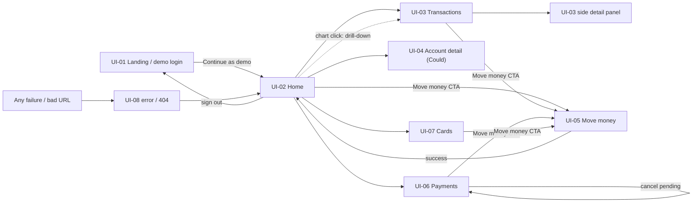

# UI Brief — Oakfern

> Implementation conventions are binding and live in `.harness/skills/ui-system/SKILL.md`. This
> brief decides **what** the product looks and feels like; the skill decides **how** every component
> must be built. Where they overlap, the skill wins on mechanics and this brief wins on identity.
> Wireframes for UI-02 and UI-03 are in §8, as required by KICKOFF §3.9, for approval at
> 🚦 G-Foundational.

## 1. Direction

| Aspect | Decision |
|---|---|
| 3 adjectives | **calm · precise · trustworthy** |
| Brand name | **Oakfern** (OQ-001, approved in Round 0). Fictional and original; no relation to any real bank or fintech. |
| Wordmark | Lowercase-weighted wordmark `oakfern` in the product sans at semibold, paired with a single geometric mark: a 20x20 rounded square containing an abstract two-stroke fern/leaf glyph drawn in the accent colour. Drawn as inline SVG, no raster asset, no external logo. |
| References liked (patterns only) | **Mercury** — generous whitespace, strong typographic hierarchy, soft neutrals. **Slash** — useful data density and powerful tables. Borrowed as *patterns*, never as identity (Art. 3, mandatory stop in `CLAUDE.md`). |
| References disliked | "Rainbow" dashboards; 10+ KPI cards; decorative gradients and heavy drop shadows; red used for every outflow; full-page spinners. |
| Visual identity | **Decided** (OQ-004, approved at 🚦 G-Foundational 2026-11-09): cool **slate** neutrals plus **one accent**, a **deep teal**. The accent is used for the primary CTA, active navigation, focus rings and the primary chart series — nothing else. Green and red are **reserved for money semantics** and are always paired with a non-colour indicator (sign or icon), never colour alone (§1.1, NFR-003). |
| Typography | **Decided** (OQ-005, approved at 🚦 G-Foundational 2026-11-09): one sans, **Geist**, loaded through `next/font` (ships with Next.js, OFL, self-hosted, no extra dependency, no external font CDN). Inter was the discarded alternative. All figures use `tabular-nums`. |
| Information density | Medium-high on data surfaces (tables, lists), low on decision surfaces (Move money). Max 4 KPI tiles on Home. |
| Tone of copy | Plain, factual, second person, no exclamation marks. "Send $1,250.00", not "Let's send it!". Errors say what happened and what to do next. |

### 1.1 Token intent (values are set in code, defined for `:root` and `.dark`)

| Token | Intent |
|---|---|
| `--background` / `--foreground` | Cool near-white on light, deep slate on dark |
| `--primary` | The single **deep-teal** accent (decided, OQ-004): primary CTA, active nav, focus ring |
| `--muted` / `--muted-foreground` | Labels, secondary metadata, table chrome |
| `--border` | 1px subtle borders used instead of shadows |
| `--positive` | Green, inflow amounts only. Always accompanied by a `+` sign or an arrow (never colour alone) |
| `--foreground` (for outflows) | Outflows are neutral foreground with a `−` sign, **not** red |
| `--destructive` | Red, reserved for errors, `failed` status and destructive confirmations only — never for ordinary outflows |
| `--chart-1…5` | Chart series; `--chart-1` is the accent, the rest are neutral-to-accent steps |
| `--radius` | One radius across cards, inputs, buttons and dialogs |

## 2. Design principles (max. 5, prioritized)

| # | Principle | Consequence |
|---|---|---|
| P-1 | **The number is the hero.** Figures are large, right-aligned, `tabular-nums`, and never compete with decoration. | No gradients or illustrations on data surfaces. |
| P-2 | **One accent, semantic colour only.** Colour carries meaning (accent = action, positive = inflow, destructive = failure) and is never the only signal. | Every coloured value also has a sign, icon or label (NFR-003). |
| P-3 | **Answer in 10 seconds, then allow depth.** Home answers cash, burn, runway and recent activity above the fold; every figure is clickable to its evidence. | Charts drill down to filtered transactions (FR-025). |
| P-4 | **Money is never a surprise.** Any movement passes a review step naming source, destination, amount, method and arrival, and the button states the concrete verb and amount. | FR-029, `ui-system` rule 9. |
| P-5 | **Every state is designed.** Loading, empty and error states are content-shaped and intentional, not afterthoughts. | NFR-010; skeletons mirror the layout, never full-page spinners. |

## 3. Screen inventory

| ID | Screen | Role(s) | Purpose | FR | Priority | Spec |
|---|---|---|---|---|---|---|
| UI-01 | Landing / demo login | `anonymous` | Explain the product in one screen and get the evaluator into the demo in one click | FR-001 | Must | 001 |
| UI-02 | Home (overview) | `admin` | Cash position, 30-day flows, burn and runway, pending payments, recent activity, charts | FR-007…FR-012b, FR-021…FR-025 | Must | 002, 004 |
| UI-03 | Transactions + side detail | `admin` | Find any movement and act on it | FR-013…FR-020b | Must | 003 |
| UI-04 | Account detail | `admin` | One account's masked numbers, balance history and transactions | FR-041 | Could | 002 |
| UI-05 | Move money (multi-step dialog: form → review → result) | `admin` | Transfer internally or pay a recipient, safely | FR-026…FR-030c | Must | 005 |
| UI-06 | Payments (pending + recipients) | `admin` | Track pending payments, cancel them, manage recipients | FR-011, FR-028, FR-032 | Must | 005 |
| UI-07 | Cards | `admin` | See cards, freeze/unfreeze, set monthly limits | FR-033…FR-035 | Should | 006 |
| UI-08 | Global error and 404 states | all | Recover from a failed load or a bad URL without losing trust | FR-039 | Must | 001 (shell), 007 (polish) |

> Insights (charts) live **inside UI-02** rather than as a separate route, to keep the sidebar short
> and the 3-minute walkthrough tight. The sidebar lists Home, Transactions, Accounts, Payments and
> Cards. (Discarded alternative: a separate `/insights` route — more navigation for no new value at
> this scope.)

## 4. Navigation per role



| Role | Reachable screens |
|---|---|
| `anonymous` | UI-01, UI-08 |
| `admin` | UI-01…UI-08 (all) |
| `viewer` (future step, out of scope) | UI-01, UI-02, UI-03, UI-04, UI-08; the "Move money" CTA and the cards write actions would be absent, and the server would refuse them anyway (`roles-permissions.md`) |

## 5. Interaction patterns

| Surface | Pattern |
|---|---|
| Tables (UI-03) | Server-side sorting on date, amount, counterparty and status; sortable headers are buttons with `aria-sort`; server-side pagination with page size 25; **all state in the URL** (FR-013); row click opens the side detail; export action sits with the filter bar. Below 768 px the table becomes a card list (NFR-004). |
| Filters | A single filter bar: search input (debounced 300 ms), then account, direction, status, method, category and date-range controls. Active filters render as removable chips with a "Clear all" action. Combinations are conjunctive (FR-015). |
| Side detail panel | Right-hand sheet, focus-trapped, `Esc` to close, URL-addressable so a detail view is shareable. Contains the recategorize select and the note field. |
| Forms (UI-05) | React Hook Form + Zod, the same schema as the server where possible; validation on blur; errors linked with `aria-describedby`; submit disabled with a spinner while in flight. |
| Money actions | Always three steps: form → **review** → result. Review restates source, destination, amount, method and estimated arrival. The confirm button names the action and amount ("Send $1,250.00"). An idempotency key is minted when the dialog opens (BR-006). |
| Destructive actions | Cancel payment and freeze card use a confirmation dialog naming the specific object; the confirm button carries the verb, and `--destructive` is used only here and for failures. |
| Empty states | Icon + one-sentence explanation + the action that resolves it. The transactions empty state names the active filters and offers "Clear filters" (FR-020b). |
| Loading states | Content-shaped skeletons: KPI tiles keep their box, the table keeps its header and row rhythm, charts keep their plot area. No full-page spinner, no layout shift. |
| Error states | `error.tsx` per route segment: human sentence, a "Try again" button, and a link to Home. No stack traces. `not-found.tsx` for bad URLs. |
| Notifications | `sonner` toasts for success and recoverable failures, bottom-right (bottom-centre on mobile), auto-dismiss 4 s, dismissible, announced politely to screen readers. Never used for validation errors (those are inline). |
| Charts | Recharts via shadcn charts; `--chart-*` tokens; tooltip with formatted amount and period; compact axis format (`$1.2M`); clickable legend when multiple series; clicking a bar/point/segment navigates to UI-03 with equivalent URL filters (FR-025); each chart has a descriptive `aria-label` plus a text alternative. |
| Keyboard | Every flow completable by keyboard; visible focus ring in the accent colour; Cmd+K opens the command palette **only if** FR-040 survives the timebox. |
| Motion | Transitions <= 200 ms, limited to hover, panel/dialog open and state change; `prefers-reduced-motion` disables them. |

## 6. Accessibility and responsive

| Aspect | Decision |
|---|---|
| Target | WCAG 2.2 **AA** basics (NFR-003): Lighthouse a11y >= 95, `axe` with 0 serious/critical on UI-02, UI-03 and UI-05 |
| Priority | Desktop-first (the evaluator's likely device), mobile fully supported and tested |
| Breakpoints | 375 (mobile), 768 (tablet / table threshold), 1024 (sidebar becomes fixed), 1280 and 1440 (content capped at `max-w-screen-2xl`) |
| Non-negotiables | Text contrast >= 4.5:1 in both themes; colour never the sole signal; labels on every input; `aria-label` on every icon button; focus visible and never clipped; `aria-live` region for balance updates after a money movement |
| Dark mode | Follows the system setting with a manual toggle; the choice persists; no unstyled flash on load |

## 7. Localization

| Aspect | Decision |
|---|---|
| Languages | `en-US` only. **N/A** for multi-language: the evaluator is a US company and SP-10 mandates English. |
| Currency | USD only, via `Intl.NumberFormat('en-US', { style: 'currency', currency: 'USD' })` through the single `formatCents` helper (BR-001). Compact form (`$1.2M`) only on chart axes. |
| Numbers | `en-US` grouping; `tabular-nums` everywhere a figure appears; amounts right-aligned in tables. |
| Dates | `en-US` medium format (for example `Nov 9, 2026`) in lists, with relative phrasing for pending arrivals ("in about 2 minutes"). |
| Time zone | `America/New_York` for every displayed and bucketed date (BR-009), labelled "ET" where ambiguity is possible. |

## 8. Assets, links and wireframes

| Item | Location |
|---|---|
| Design system rules | `.harness/skills/ui-system/SKILL.md` |
| Component source | shadcn/ui components copied into `src/components/ui/` (ADR-0002) |
| Icons | `lucide-react` |
| Toasts | `sonner` |
| Design files | **N/A** — no Figma. The wireframes below plus the `ui-system` skill are the design source of truth (human's decision, for time reasons). |
| Screenshots | Produced in feature 007/008 (light and dark) for the README |

### Amendment 1 — UI-02 Home as it actually ships (2026-11-10)

> **Authorised explicitly by the Technical Director at 🚦 G-SpecPlan for feature 002, 2026-11-10.**
> The original UI-02 Home wireframes below are **kept visible as the approved historical record**
> and are **superseded** by this amendment; they are not overwritten. The UI-03 Transactions
> wireframes are **unchanged** and still binding for feature 003.

**What was removed from UI-02 Home, and why.**

| # | Removed from the approved wireframe | Reason | Trace |
|---|---|---|---|
| 1 | **CASH FLOW · last 6 months** panel (bars + `3M/6M/12M` selector + bar → UI-03 drill-down) | FR-021 / FR-024 / FR-025 belong to feature **004 `cash-insights`, CUT 2026-11-09** | `docs/roadmap.md`; OQ-002-04 A |
| 2 | **SPENDING BY CATEGORY · last 30 days** panel | FR-023, same cut feature **004** | `docs/roadmap.md`; OQ-002-04 A |
| 3 | **Cash sparkline** under the TOTAL CASH figure | FR-012b **deferred** by cut ladder **L-4** at the same gate; no time series ships, and `recharts` stays uninstalled | `docs/requirements/functional.md` Amendment C-2; `specs/002-account-overview/plan.md` §8 |
| 4 | **PENDING PAYMENTS** panel with its count and `[Cancel]` buttons | Cut ladder **L-2**: the pending rows move **into** the recent-transactions list. The `[Cancel]` control is gone because FR-032 lives in feature **005 `move-money`, CUT 2026-11-10** — a dead control is worse than an honest sentence | `docs/requirements/functional.md` Amendment C-1; OQ-002-01 A |
| 5 | **"↑ Move money"** primary CTA (desktop header and the sticky mobile button) | 005 is cut, so `/move-money` is a placeholder; a primary CTA that leads nowhere is the worst signal on the screen the evaluator judges | OQ-002-03 A |
| 6 | **"↑ 5.1 % vs prev" / "↓ 2.3 % vs prev"** deltas on the in/out tiles | Not required by any FR, and a second 30-day window costs time the box does not have | ASM-002-04; cut ladder L-1 |
| 7 | **5-item sidebar** (Home, Transactions, Accounts, Payments, Cards) | Already superseded in feature 001 by **Cut C1**: the sidebar is **3 items** — Home, Transactions, Move money (`AC-001-13` amended) | `MEMORY.md`; spec 001 |

**What is unchanged:** the KPI order (total cash → money in → money out → runway), the accounts card
list with masked numbers and an available-balance line, the recent-transactions list with "View
all → UI-03", the identity rules of §1 (deep-teal single accent, green/red reserved for money
semantics and always paired with a sign, Geist, `tabular-nums`), and the §6 responsive and
accessibility rules. `docs/ux/ui-brief.md` §5's "Recharts via shadcn charts" row is **dormant** for
this delivery: nothing charted ships, so no charting library is installed.

#### UI-02 Home as shipped — desktop (>= 1280 px)

```text
┌──────────────────────────────────────────────────────────────────────────────────────────────┐
│ ┌──────────────┐ ┌─────────────────────────────────────────────────────────────────────────┐ │
│ │ ◆ oakfern    │ │                                            ┃ ◑ theme ┃ HC  Hernán  ▾   │ │
│ ├──────────────┤ └─────────────────────────────────────────────────────────────────────────┘ │
│ │ ▸ Home       │                                                                             │
│ │   Transact…  │   Good morning, Hernán                                                      │
│ │   Move money │   Tuesday, Nov 10 · ET                   (no "Move money" CTA — 005 is cut) │
│ │              │                                                                             │
│ │              │   ┌──────────────────┬──────────────────┬──────────────────┬─────────────┐  │
│ │              │   │ TOTAL CASH       │ MONEY IN (30D)   │ MONEY OUT (30D)  │ RUNWAY      │  │
│ │              │   │ $1,284,310.55    │ +$312,480.00     │ −$198,120.44     │ 18.4 months │  │
│ │              │   │ 4 accounts       │ excl. internal   │ excl. internal   │ burn $69.4k │  │
│ │              │   └──────────────────┴──────────────────┴──────────────────┴─────────────┘  │
│ │              │          (no sparkline — L-4)        (no "vs prev" deltas — ASM-002-04)     │
│ │              │                                                                             │
│ │              │   ┌─────────────────────────────────────────┬─────────────────────────────┐ │
│ │              │   │ RECENT TRANSACTIONS         View all →  │ ACCOUNTS                    │ │
│ │              │   │ ⬤ N  Northwind Supply  ACH             │ Operating · checking        │ │
│ │              │   │      pending · Expected Nov 12          │ ••••4821                    │ │
│ │              │   │                          −$12,400.00    │ $612,044.10                 │ │
│ │              │   │ ⬤ S  Stripe payout    Revenue          │ avail. $598,844.10          │ │
│ │              │   │      Nov 10 · ACH        +$48,210.00    │ ─────────────────────────── │ │
│ │              │   │ ⬤ A  AWS              Cloud            │ Payroll · checking ••••7310 │ │
│ │              │   │      Nov 9 · Card         −$9,142.77    │ $142,880.00                 │ │
│ │              │   │ ⬤ G  Gusto payroll    Payroll          │ avail. $142,880.00          │ │
│ │              │   │      Nov 8 · ACH        −$46,200.00     │ ─────────────────────────── │ │
│ │              │   │ ⬤ →  To Reserve       Internal         │ Reserve · savings ••••1192  │ │
│ │              │   │      Nov 8 · Internal   −$50,000.00     │ $228,500.00                 │ │
│ │              │   │ ⬤ F  Figma            Software         │ avail. $228,500.00          │ │
│ │              │   │      Nov 7 · Card        −$1,440.00     │ ─────────────────────────── │ │
│ │              │   │ … (>= 8 rows, newest first)             │ Treasury ••••0574           │ │
│ │              │   │ ───────────────────────────────────────  │ $300,886.45                 │ │
│ │              │   │ Pending payments are read-only in this  │ avail. $300,886.45          │ │
│ │              │   │ round — cancelling is not available.    │                             │ │
│ │              │   └─────────────────────────────────────────┴─────────────────────────────┘ │
│ └──────────────┘                                                                             │
└──────────────────────────────────────────────────────────────────────────────────────────────┘
```

Notes that are requirements: the pending row carries a **text** badge (`pending · Expected Nov 12`),
not a colour alone (NFR-003); the honest sentence is a **footnote of the list**, with **no button,
link or disabled control** anywhere (AC-002-22); internal legs are listed and labelled `Internal`
even though BR-011 keeps them out of the two flow tiles (AC-002-25).

#### UI-02 Home as shipped — mobile (375 px)

```text
┌───────────────────────────────┐
│ ☰  ◆ oakfern         ◑   HC   │   ☰ opens the sidebar as a sheet (3 items)
├───────────────────────────────┤
│ Good morning, Hernán          │   no sticky CTA — 005 is cut
│ TOTAL CASH                    │
│ $1,284,310.55                 │   no sparkline (L-4)
│ ───────────────────────────── │
│ MONEY IN (30D)  +$312,480.00  │   KPI tiles stack 1-up
│ MONEY OUT (30D) −$198,120.44  │
│ RUNWAY          18.4 months   │
│ ───────────────────────────── │
│ RECENT            View all →  │
│ Northwind Supply  −$12,400.00 │
│ pending · Expected Nov 12     │
│ Stripe payout     +$48,210.00 │
│ Nov 10 · ACH · Revenue        │
│ AWS                −$9,142.77 │
│ Nov 9 · Card · Cloud          │
│ Pending payments are          │
│ read-only in this round.      │
│ ───────────────────────────── │
│ ACCOUNTS                      │
│ Operating ••••4821            │   accounts as a card list, not a table
│ $612,044.10                   │
│ avail. $598,844.10            │
└───────────────────────────────┘
```

Figures above are illustrative; every number comes from `getOverview` and no component recomputes
one (NFR-011, AC-002-30). `scrollWidth <= innerWidth` is asserted in CI at 375 px and 1280 px
(AC-002-31) — the laptop is never the authority.

---

### UI-02 Home — desktop (>= 1280 px) · **SUPERSEDED by Amendment 1 (kept as the approved record)**

```text
┌──────────────────────────────────────────────────────────────────────────────────────────────┐
│ ┌──────────────┐ ┌─────────────────────────────────────────────────────────────────────────┐ │
│ │ ◆ oakfern    │ │  Search transactions…              ⌘K      ┃ ◑ theme ┃ HC  Hernán  ▾   │ │
│ ├──────────────┤ └─────────────────────────────────────────────────────────────────────────┘ │
│ │ ▸ Home       │                                                                             │
│ │   Transact…  │   Good morning, Hernán                      ┌───────────────────────────┐   │
│ │   Accounts   │   Monday, Nov 9 · ET                        │   ↑  Move money           │   │
│ │   Payments   │                                             └───────────────────────────┘   │
│ │   Cards      │                                                                             │
│ │              │   ┌──────────────────┬──────────────────┬──────────────────┬─────────────┐  │
│ │              │   │ TOTAL CASH       │ MONEY IN (30D)   │ MONEY OUT (30D)  │ RUNWAY      │  │
│ │              │   │ $1,284,310.55    │ +$312,480.00     │ −$198,120.44     │ 18.4 months │  │
│ │              │   │ ╭╮__╭─╮_╭──╯ ▁▂▄ │ ↑ 5.1% vs prev   │ ↓ 2.3% vs prev   │ burn $69.4k │  │
│ │              │   └──────────────────┴──────────────────┴──────────────────┴─────────────┘  │
│ │              │                                                                             │
│ │              │   ┌─────────────────────────────────────────┬─────────────────────────────┐ │
│ │              │   │ CASH FLOW · last 6 months   [3M|6M|12M] │ ACCOUNTS                    │ │
│ │              │   │  $400k┤  ▆     ▆     ▆  ▆     ▆     ▆   │ Operating · checking        │ │
│ │              │   │       │  ▆  ▃  ▆  ▃  ▆  ▆  ▃  ▆  ▃  ▆   │ ••••4821                    │ │
│ │              │   │  $200k┤  ▆  ▃  ▆  ▃  ▆  ▆  ▃  ▆  ▃  ▆   │ $612,044.10                 │ │
│ │              │   │     $0┼──┴──┴──┴──┴──┴──┴──┴──┴──┴──┴─  │ avail. $598,844.10          │ │
│ │              │   │         Jun Jul Aug Sep Oct Nov          │ ─────────────────────────── │ │
│ │              │   │  ▆ in   ▃ out      (click a bar → UI-03) │ Payroll · checking ••••7310 │ │
│ │              │   └─────────────────────────────────────────┤ $142,880.00                 │ │
│ │              │   ┌─────────────────────────────────────────┤ ─────────────────────────── │ │
│ │              │   │ SPENDING BY CATEGORY · last 30 days     │ Reserve · savings ••••1192  │ │
│ │              │   │ Payroll    ████████████████  $92,400.00 │ $228,500.00                 │ │
│ │              │   │ Cloud      ███████           $38,120.00 │ ─────────────────────────── │ │
│ │              │   │ Rent       █████             $24,000.00 │ Treasury ••••0574           │ │
│ │              │   │ Marketing  ███               $18,600.00 │ $300,886.45                 │ │
│ │              │   │ Other      ██                $25,000.44 │                             │ │
│ │              │   └─────────────────────────────────────────┴─────────────────────────────┘ │
│ │              │                                                                             │
│ │              │   ┌─────────────────────────────────────────┬─────────────────────────────┐ │
│ │              │   │ RECENT TRANSACTIONS         View all →  │ PENDING PAYMENTS        3   │ │
│ │              │   │ ⬤ S  Stripe payout    Revenue          │ Northwind Supply            │ │
│ │              │   │      Nov 9 · ACH         +$48,210.00    │ ACH · arrives in ~2 min     │ │
│ │              │   │ ⬤ A  AWS              Cloud            │ −$12,400.00        [Cancel] │ │
│ │              │   │      Nov 8 · Card        −$9,142.77     │ ─────────────────────────── │ │
│ │              │   │ ⬤ G  Gusto payroll    Payroll          │ Hartley Legal               │ │
│ │              │   │      Nov 7 · ACH        −$46,200.00     │ Wire · arrives in ~30 s     │ │
│ │              │   │ ⬤ →  To Reserve       Internal         │ −$8,750.00         [Cancel] │ │
│ │              │   │      Nov 7 · Internal   −$50,000.00     │ ─────────────────────────── │ │
│ │              │   │ ⬤ F  Figma            Software         │ Vista Insurance             │ │
│ │              │   │      Nov 6 · Card        −$1,440.00     │ ACH · arrives in ~1 min     │ │
│ │              │   │                                         │ −$3,100.00         [Cancel] │ │
│ │              │   └─────────────────────────────────────────┴─────────────────────────────┘ │
│ └──────────────┘                                                                             │
└──────────────────────────────────────────────────────────────────────────────────────────────┘
```

### UI-02 Home — mobile (375 px) · **SUPERSEDED by Amendment 1 (kept as the approved record)**

```text
┌───────────────────────────────┐
│ ☰  ◆ oakfern         ◑   HC   │   ☰ opens the sidebar as a sheet
├───────────────────────────────┤
│ ┌───────────────────────────┐ │
│ │  ↑ Move money             │ │   full-width primary CTA, sticky above the fold
│ └───────────────────────────┘ │
│ TOTAL CASH                    │
│ $1,284,310.55                 │
│ ╭╮__╭─╮_╭──╯ ▁▂▄              │
│ ───────────────────────────── │
│ MONEY IN (30D)  +$312,480.00  │   KPI tiles stack 1-up
│ MONEY OUT (30D) −$198,120.44  │
│ RUNWAY          18.4 months   │
│ ───────────────────────────── │
│ CASH FLOW      [3M|6M|12M]    │
│  ▆▃ ▆▃ ▆▃ ▆▃ ▆▃ ▆▃            │
│  Jun Jul Aug Sep Oct Nov      │
│ ───────────────────────────── │
│ ACCOUNTS                      │
│ Operating ••••4821            │   accounts as a card list, not a table
│ $612,044.10                   │
│ ───────────────────────────── │
│ RECENT            View all →  │
│ Stripe payout     +$48,210.00 │
│ Nov 9 · ACH · Revenue         │
│ AWS                −$9,142.77 │
│ Nov 8 · Card · Cloud          │
└───────────────────────────────┘
```

### UI-03 Transactions + side detail — desktop (>= 1280 px)

```text
┌──────────────────────────────────────────────────────────────────────────────────────────────┐
│ ┌──────────────┐ ┌─────────────────────────────────────────────────────────────────────────┐ │
│ │ ◆ oakfern    │ │  Search transactions…              ⌘K      ┃ ◑ theme ┃ HC  Hernán  ▾   │ │
│ ├──────────────┤ └─────────────────────────────────────────────────────────────────────────┘ │
│ │   Home       │   Transactions                               ┌───────────────────────────┐  │
│ │ ▸ Transact…  │   1,643 results                              │   ↑  Move money           │  │
│ │   Accounts   │                                              └───────────────────────────┘  │
│ │   Payments   │   ┌──────────────────────────────────────────────────────────────────────┐  │
│ │   Cards      │   │ 🔍 aws            │ Account ▾ │ Dir ▾ │ Status ▾ │ Method ▾ │ … ▾   │  │
│ │              │   │ Category: Cloud ✕   Date: Oct 1 – Nov 9 ✕          Clear all        │  │
│ │              │   │                                              [ ⭳ Export CSV ]       │  │
│ │              │   └──────────────────────────────────────────────────────────────────────┘  │
│ │              │   ┌─────────────────────────────────────────┐┌────────────────────────────┐ │
│ │              │   │ DATE ▼ │ COUNTERPARTY │ CAT │  AMOUNT  ││ ✕  TRANSACTION             │ │
│ │              │   ├────────┼──────────────┼─────┼──────────┤│                            │ │
│ │              │   │ Nov 8  │ ⬤A AWS       │Cloud│ −$9,142.77││ AWS                        │ │
│ │              │   │  Card  │ us-east-1    │     │  posted  ││ −$9,142.77                 │ │
│ │              │   ├────────┼──────────────┼─────┼──────────┤│ posted · Card              │ │
│ │              │   │ Oct 8  │ ⬤A AWS       │Cloud│ −$8,904.12│├────────────────────────────┤ │
│ │              │   │  Card  │ us-east-1    │     │  posted  ││ Account   Operating ••4821 │ │
│ │              │   ├────────┼──────────────┼─────┼──────────┤│ Card      Virtual ••3307   │ │
│ │              │   │ Oct 2  │ ⬤A AWS       │Cloud│   −$412.40││ Created   Nov 8, 2026 ET   │ │
│ │              │   │  Card  │ support plan │     │  posted  ││ Posted    Nov 8, 2026 ET   │ │
│ │              │   ├────────┼──────────────┼─────┼──────────┤│ Memo      us-east-1        │ │
│ │              │   │        │              │     │          ││                            │ │
│ │              │   │   (rows … page size 25)                │├────────────────────────────┤ │
│ │              │   │                                        ││ Category  [ Cloud      ▾ ] │ │
│ │              │   ├────────────────────────────────────────┤│ Note                       │ │
│ │              │   │ ‹ Prev   Page 1 of 3   Next ›   25 ▾   ││ ┌────────────────────────┐ │ │
│ │              │   └─────────────────────────────────────────┘│ │ Reviewed with finance  │ │ │
│ │              │                                              │ └────────────────────────┘ │ │
│ │              │   URL ?q=aws&category=cloud&from=2026-10-01  │        [ Save changes ]    │ │
│ │              │       &to=2026-11-09&sort=-date&page=1       └────────────────────────────┘ │
│ └──────────────┘                                                                             │
└──────────────────────────────────────────────────────────────────────────────────────────────┘
```

### UI-03 Transactions — mobile (375 px) and the required states

```text
┌───────────────────────────────┐   ┌───────────────────────────────┐
│ ☰  Transactions        ◑  HC  │   │ EMPTY STATE (FR-020b)         │
├───────────────────────────────┤   ├───────────────────────────────┤
│ 🔍 aws                        │   │            ⌕                  │
│ [Filters 2 ▾]  [⭳ CSV]       │   │   No transactions match       │
│ Cloud ✕  Oct 1 – Nov 9 ✕      │   │   Active: "aws", Cloud,       │
├───────────────────────────────┤   │   Oct 1 – Nov 9               │
│ ⬤A AWS            −$9,142.77 │   │   [ Clear filters ]           │
│    Nov 8 · Card · Cloud   ›   │   └───────────────────────────────┘
├───────────────────────────────┤   ┌───────────────────────────────┐
│ ⬤A AWS            −$8,904.12 │   │ LOADING STATE                 │
│    Oct 8 · Card · Cloud   ›   │   ├───────────────────────────────┤
├───────────────────────────────┤   │ ▒▒▒▒▒▒▒▒▒▒▒▒      ▒▒▒▒▒▒▒▒   │
│ ⬤A AWS              −$412.40 │   │ ▒▒▒▒▒▒▒▒          ▒▒▒▒▒       │
│    Oct 2 · Card · Cloud   ›   │   │ ▒▒▒▒▒▒▒▒▒▒▒▒      ▒▒▒▒▒▒▒▒   │
├───────────────────────────────┤   │ (content-shaped skeleton,     │
│  ‹ Prev   1 / 3   Next ›      │   │  same row rhythm, no spinner) │
└───────────────────────────────┘   └───────────────────────────────┘
       row tap opens the detail           ┌───────────────────────────────┐
       as a bottom sheet                  │ ERROR STATE (FR-039)          │
                                          ├───────────────────────────────┤
                                          │   ⚠  We couldn't load your    │
                                          │      transactions.            │
                                          │      [ Try again ]  Go home   │
                                          └───────────────────────────────┘
```

> **Approved at 🚦 G-Foundational, 2026-11-09, with no changes:** the layouts above (KPI order on
> Home, charts inside Home, 5-item sidebar, right-hand detail panel on Transactions), together with
> OQ-004 (deep-teal single accent on cool slate neutrals) and OQ-005 (**Geist** via `next/font`).
> These are decided; agents must not re-open them without an amendment.
>
> **Amendment 1 (2026-11-10) is that amendment, for UI-02 Home only** — authorised explicitly by the
> Technical Director at 🚦 G-SpecPlan for feature 002 after features 004 and 005 were cut. Read it
> above: the UI-02 Home blocks in this section are the historical approved record, and the "as
> shipped" wireframes in Amendment 1 are what feature 002 builds. **UI-03 Transactions is untouched
> and still binding.** No further change to this section without a new, dated, human-approved
> amendment.
